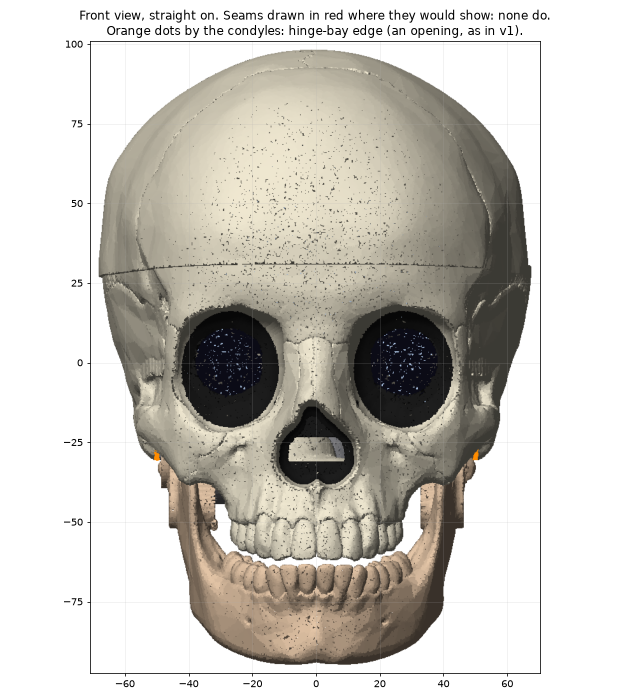
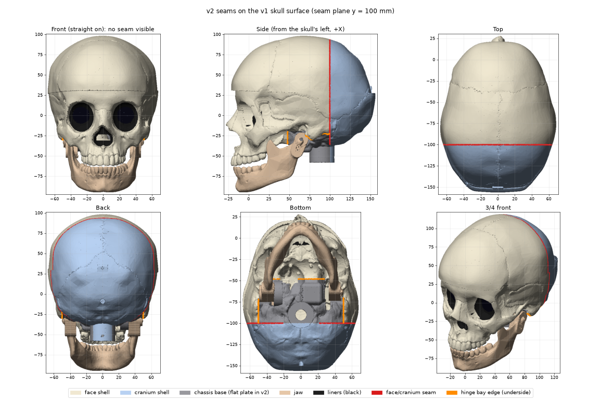
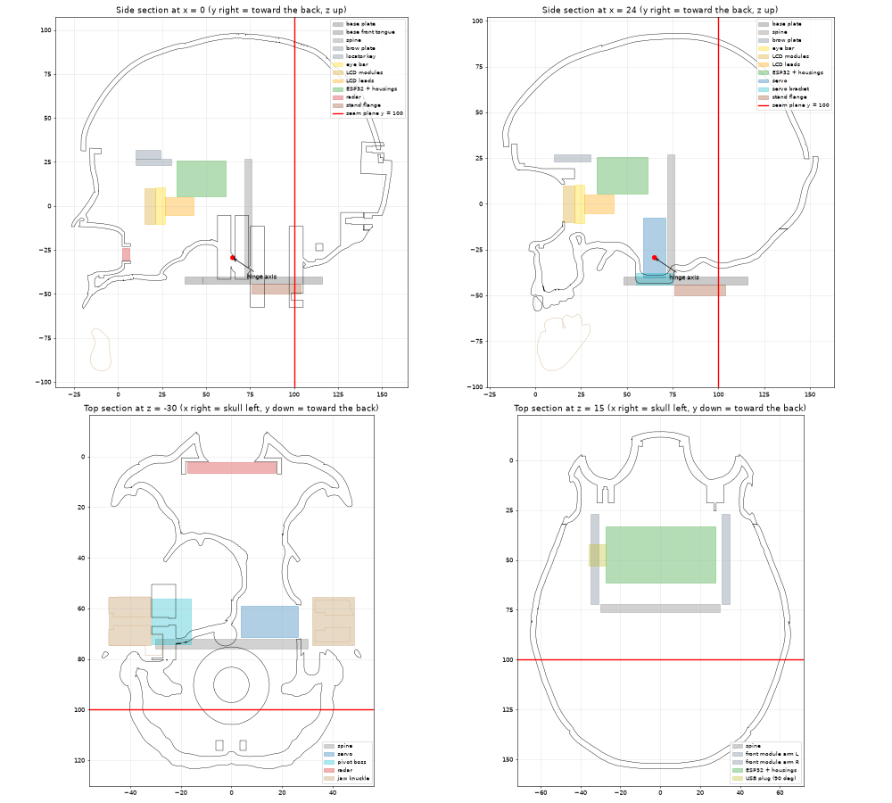

# Skull v2 architecture

This is the Architect's design for v2 of the printed skull. **Revision 2** (§13) fixes the ten places where the mock-up found the dimensions don't fit together; where §13 and an earlier section disagree, §13 wins. It answers `docs/skull-v2-plan.md` and is the review gate before any code. The builders code against it; `hardware/skull_v2/interfaces.py` is made from the Interfaces table (§4).

All numbers are in the v1 eye frame:
- origin midway between the orbits;
- −Y is the way the face looks;
- +X is the skull's left (the viewer's right), the L eye and the servo side;
- +Z is up.

Renders are in `docs/skull-v2/`. They were made by `hardware/skull_v2/proto/` from the v1 STLs, put back into the eye frame. They are light point-splat renders, not the build.

## 0. Summary

```
                      stand (new top flange)
                         │ 2 x M3 from below
   ┌─────────────────────┴──────────────────────────┐
   │ CHASSIS BASE  flat plate z -44..-40, spine y 72..76 │  prints plate-down, ~2 h
   └──┬──────────────┬──────────────┬───────────────┬───┘
      │ 2 x M3 (Y)   │ 2 x M3 (Z)   │ 2 x M3 (Z)    │ tongues: front and rear
 FRONT MODULE    SERVO BRACKET   PIVOT BRACKET      │
 eye bar, LCDs,  + servo         + stop block       │
 ESP32           └──── JAW (horn + pivot) ───┘      │
      ▲                                              │
      │ locator key (slip)                           │
 FACE SHELL ─── slides back (+Y) ──── 2 x M3 from below into the front tongue
      ║ lap joint at the seam plane y = 100
 CRANIUM SHELL ─ slides forward (−Y) ── 2 x M3 from below into the rear tongue
```

- **One seam plane, y = 100**, 15 mm behind the widest point of the head. Nothing of it can be seen from the front (§2).
- **Both shells print rim-down on that plane, with no support.** Each slides onto the chassis along Y, which is also its print axis. Every opening a shell needs for the chassis is then a vertical-walled prism in the print. The space between the skin and that cavity is modelled solid and printed as sparse infill (§1, Face shell).
- **The chassis is a flat base plate with a spine, plus a front module.** The front module carries the eye bar, both LCDs and the ESP32, and it is wired on the bench before it goes in. The servo and pivot brackets are bolt-on. The jaw mechanism sits on the open chassis, and its screws are driven before any shell goes on.
- **All 15 inserts are in chassis, jaw-mechanism or stand parts** (table in §13). The shells only take screw heads. Every shell screw goes in from below and can't be seen.

### Fixed source

The v1 lesson is that the face only rebuilt identically from main's cached meshes, because the ICP jaw fit and the shell union aren't reproducible.

**Decision:** commit the source once, already in the eye frame:
- `hardware/skull_v2/src/cranium_eye.stl`: v1 `cache/cranium_src.stl`, scaled and moved into the eye frame;
- `hardware/skull_v2/src/jaw_eye.stl`: the jaw in its closed pose (v1 fit plus the 9° close).

Both are CC0 (Printables 2770 and 293680). Decimate them to under 25 MB together. `interfaces.py` records their sha256. The v2 build reads only these files, and never re-runs the union or the ICP.

## 1. Part list

Times assume a Bambu H2D, PLA, 0.2 mm layers, 4 walls. Skin prints at about 20 cm³/h and sparse infill at about 60 cm³/h. Check every time in Bambu Studio.

| Part | Role | Size (mm) | Print pose | Bed face | Support | Time |
|---|---|---|---|---|---|---|
| **Face shell** | The whole visible front: brow, sockets, nose, cheekbones, arches, upper teeth, forehead and top back to y = 100. Carries the liners and the radar pocket. | 134 W × 160 H × 128 deep | Seam rim down, face up (print +Z = skull −Y) | The face lip's end face on the seam plane, about 330 mm × 2.0 = **660 mm²**, plus the side-wall ends | **None.** The interior follows the 40° fill rule. A 45° backing goes behind the upper teeth, hidden in the mouth. | ~9 h: skin ~150 cm³, sparse fill ~1 L at 8 % |
| **Cranium shell** | The back of the head and the top behind y = 100, and the base behind the stand column | 134 W × 150 H × 64 deep | Tongue tip down, back of the head up (print +Z = skull +Y) | The tongue tip on y = 92, about 400 mm × 1.6 = **640 mm²** | **None** (fill rule at the occiput, ~300 cm³ sparse) | ~4 h |
| **Chassis base** | Flat plate under the hinge, servo and stand; pads, servo pocket, spine at y 76–80; front and rear tongues for the shells; 8 inserts (§13) | 92 W × 78 deep × 71 H | Plate down (as fitted) | Plate underside, **~5,000 mm²** | None. The tongue joggles rise at 45°; the spine top is a top surface. | ~2 h |
| **Front module** | Brow plate with two eye-bar posts (insert and key peg), two side arms back to the spine, ESP32 ledges, face-shell locator key; 3 inserts | 70 W × 62 deep × 36 H | Front face down (print +Z = skull +Y) | Front faces of the brow plate, posts and key at y = 10: **~520 mm²**. Widen the brow plate's front edge if this comes out under 500 mm². | None. The arms' front edges rise from the brow plate at 45°. | ~1.2 h |
| **Servo bracket** | Re-stacked (§13): servo plate under the tabs stands in a pocket in the base plate; a foot in front of the servo screws to a pad | 15.6 × 25.6 × 36 | v1 pose (servo plate's outer face down) | 392 mm² (≥ 30 % of its 486 mm² footprint) | None (v1: 0.5 mm²) | ~15 min |
| **Pivot bracket** | Block inboard of the finger (x −26.5…−18) with an r 4 nose out to the pivot face; the jaw pivot insert and the stop insert, both X (§13) | 13.5 × 38.5 × 13 | Inner face (+X) down, nose up, so both X inserts stand vertical | ~470 mm² | None | ~20 min |
| **Stop block** | Bolt-on C-shaped hard stop round the jaw's finger (closed −0.5°, open 20°), slid on after the jaw (§13) | 7 × 16 × 19 | Inner face (+X) down | ≥ 30 % of footprint | None | ~10 min |
| **Jaw** | v1 jaw, closed pose, knuckles, horn screws and pivot hole | 99 × 97 × 74 | **Mandibular plane down**: tilted about 12° so that the chin bottom and both angles touch the bed, on a 1.5 mm sacrificial flat along the inferior border | Inferior-border strip, ~1,000 mm² (the builder confirms the number) | Under the front of the chin only, ≤ 15 mm tall. Knuckles grow on 45° gussets, with no trees under them. | ~3 h |
| **Stand** | v1 stand, with a new top: a Ø56 × 8 flange (45° chamfer under it) and 2 Z inserts in its top face (§3, Exceptions) | Ø110 × 92 (z −136…−44) | Base down | 8,900 mm² | None | ~3 h |
| Liners (eyes, nose) | v1 parts, glued into the face shell | v1 | v1 | v1 | v1 | already printed |

Total is about 23 h. The prints that matter first are short: chassis base and front module about 3 h, the jaw mechanism about 4 h.

**Face shell, fill rule.** The face shell prints rim-down. The inside of the forehead is then a ceiling 50–120 mm above the bed, too high for any support (rule 4). Every interior ceiling is therefore kept at 40° or steeper. The cavity is the largest self-supporting space inside the skin, worked out top-down layer by layer: `C(z) = A(z) ∩ dilate(C(z+1), dz·cot 40°)`. To that are added the chassis keep-outs, swept along Y. Everything else inside the skin is modelled solid.

The prototype (`proto/fill_estimate.py`, 2 mm voxels) gives:

| Shell | Enclosed | Cavity | Solid fill |
|---|---|---|---|
| Face shell | ~1,500 cm³ | ~360 cm³ | ~1,060 cm³ |
| Cranium shell | ~590 cm³ | ~230 cm³ | ~310 cm³ |

At 8 % gyroid (or Bambu's Lightning infill) the face shell's fill is about 85 cm³ of plastic, or about 100 g and about 1.5 h. That is the price of a face shell with no support and no scars. The alternative is in §12.

## 2. Seams





| Seam | Line | Parts | Seen from |
|---|---|---|---|
| **S1** | Plane **y = 100**: over the top 30 mm behind the vertex (y 69), down both sides 12–15 mm behind the widest point (y 83–88), to the mastoids | face shell / cranium shell | Side, top and back. **Never from the front.** |
| **S2** | Underside: the front tongue at y 38–48 behind the palate, and the bay edges at \|x\| 30–50 under the hinge | face shell / chassis base | Below only |
| **S3** | Underside behind the stand column, y 100–116 | cranium shell / chassis base | Below only |
| Liner rims | Orbit and nasal rims (black inserts, v1) | liners / face shell | Front, by design: a colour edge |

**Why y = 100.**
- `docs/skull-v2/front_visibility.png` marks every point of the v1 surface that is seen straight from the front (red), or from up to 15° to the side or above (orange). Orange covers a viewer standing over a table-top skull, and the perspective at about 1 m.
- The seen region runs back to the silhouette: the widest point of the head (y 83–88), and the top at y ≈ 90 for the 15° view.
- A plane at y = 100 clears both. The seam check in `proto/seams.py` found **0 of 8,692 S1 seam points visible** in any of the 9 views of the margin cone. At y = 90 and 95 the plane is still seen from 15° to the side.
- A plane gives both shells a flat rim to print on, which no anatomical line does.

**The coronal suture was rejected.** It crosses the top at y ≈ 48, in front of the vertex, so it can be seen from the front. No anatomical line runs behind the silhouette all the way round, so S1 earns no anatomy bonus.

**What does show from the front.**
- In the front render, two orange dots sit by the condyles at |x| ≈ 50, z ≈ −28. They are the edge of the hinge bay, the opening the jaw knuckles sit in. They show in v1 as well, and they are not a part seam.
- The faint line across the forehead in the renders is v1's cap cut in the v1 mesh. v2 doesn't have it.

**S1 from the side and back.** It is a 2.2 mm V-groove: the cranium's outer half starts with a 45° chamfer so it prints without support (§5, J1). Fill it or paint it if you want it gone. It reads like a suture.

## 3. Chassis

The chassis is the default home for hardware. It is built as four quick parts so that a wrong mount costs at most 2 h of printing. The chassis base and the front module are the chassis builder's. The servo bracket, pivot bracket and stop block are the jaw builder's (exception 2).

```
 side view (x = 0), y to the right
                    brow plate + key        spine
   face ◄─  ┌────────────────┐               ┃
            │ posts│bar│LCD   ESP32 on ledges┃ ← front module bolts to the spine (2 x M3 along Y)
            └──────┴───┴─────────────────────┨
                         servo  pivot bkt    ┃
          front tongue ┌──────────────────────────────┐ rear tongue
     (joggled up) ─────┘   base plate z -44..-40      └───── (joggled up)
                                ▲ stand flange (2 x M3 from below)
```



These are sections of the v1 skull (black) and jaw (tan) with the v2 envelopes from §4 drawn over them. The red line is S1. The side sections are at x = 0 and x = 24, through the servo and the LCD leads. The top sections are at z = −30 (the hinge) and z = 15 (the eyes and the ESP32).

**Base** (plate-down print):
- **Plate:** z −44 to −40, y 48 to 104.
  - |x| ≤ 30 between the jaw knuckles (y < 80);
  - |x| ≤ 49.5 behind them (y 81–104, rev 2).
- **Front tongue:** y 38–48, |x| ≤ 22. It is joggled up on a 45° ramp to z −38 to −34, so the face shell's flange under it sits at the natural base level.
- **Rear tongue:** y 104–116, |x| ≤ 30, joggled up the same way to z −38 to −34.
- **Spine:** y 76–80 (rev 2), from the plate up to z +27.
  - |x| ≤ 16 below z −20, 45° chamfer to ≤ 35 at z −1 (rev 2).
  - Two horizontal teardrop clearance holes for the front-module screws.
  - A cable notch at x −14 to −8 at the bottom, for USB.
- **Inserts**, all vertical (Z):
  - 2 servo bracket, 2 pivot bracket;
  - 2 face shell, at (±12, 44) in the front tongue;
  - 2 cranium shell, at (±20, 110) in the rear tongue;
  - 2 stand, at (±24, 90), either side of the column.
  - Shell and stand screws come from below, so their inserts are pressed from the top and the screw enters the insert's far end. The insert seats on its bore shoulder under load.
- **Plate hole** Ø16 at (0, 90) for the USB cable. The USB-A plug passes.
- The plate is the visible skull base between the jaw rami. It is flat, and seen from below only.

**Front module** (front-down print):
- **Brow plate:** z 23–27, y 10–30, |x| ≤ 35.
- **Posts:** in front of the eye-bar bosses at (±27.5, z 16), y 12–21.2.
  - The left post has the bar insert (axis −Y).
  - The right post has a Ø3 key peg. It grows +Y, so it grows upward in the print.
- **Side arms:** |x| 31–35, y 27–72, z −4 to 27. Their front edges rise from the brow plate at 45°. Their rear faces carry the 2 Y-axis inserts at (±33, 72, z 10).
- **ESP32 ledges:** on the arms' inner faces at z 22, under the board ends. The ESP32 is held by a zip tie, as in v1.
  - A window in the −X arm takes the 90° USB plug. Give the window a pointed top, since it is a wall in the print.
- **Locator key:** a block on top of the brow plate: x ±8, z 27–32, y 10–24, with 1.5 mm 45° lead-in chamfers on its front edges. It is the face shell's main locator in x and z, and it sits next to the eyes (§5, J4).

**Exceptions**, where hardware does not sit on the chassis:

| Item | Where | Reason |
|---|---|---|
| Radar (HLK-LD2410C) | Pocket on the face shell, behind the nasal liner's 1.8 mm window | The window is the nasal liner's floor, and the visible surface has to carry it. The pocket is a small vertical-walled feature in the face print. The lead plugs into the ESP32 before the face shell slides on (§8). |
| Servo, horn, jaw, pivot, stops | Servo bracket and pivot bracket, bolted to the base; jaw on the horn and pivot | One mechanism. The hinge axis (y 65.13, z −29.43) and the horn face (x 33) fix the servo position, not the chassis layout. The brackets are separate so that the jaw builder owns the whole mechanism and a geometry change reprints 15 minutes of brackets, not the base. |
| Liners | Glued into the face shell (v1) | Colour inserts on the visible surface |
| Face locator socket | Face shell | The face shell has to be located next to the eyes; the key half is on the chassis |
| Stand fixing | New Ø56 top flange on the stand, 2 × M3 from below into the base | v1's radial screw needs an insert along Y in a neck tube under the plate. That is below the bed in a plate-down print and horizontal in any other pose. v1's stand is not printed yet. **User decision** (§12). |

## 4. Interfaces (draft of `interfaces.py`)

Eye frame, mm. "Owner" is the builder whose part must stay inside the envelope; everyone else keeps clear of it.

| Datum | Value | Owner / users |
|---|---|---|
| Source meshes | `src/cranium_eye.stl`, `src/jaw_eye.stl` + sha256 | common / all |
| Seam plane S1 | y = 100.0; lap band y 92–100 (§5, J1) | shells |
| Screen centres | (±27.5, 15.0 glass, 0.0) | front module / shells (liner bezel 0.75 in front, y 14.25) |
| Eye bar | back face y 26.85, front 21.2; plate \|x\| ≤ 31.64, \|z\| ≤ 10.4; bosses Ø9 at (±27.5, z 16), slot Ø3.6 × 3 vertical | v1 part / front module |
| Bar bolt | M3×12 + Ø9 washer, at (−27.5, z 16), axis −Y, insert face y 21.2; key peg Ø3 at (+27.5, 16) | front module |
| LCD modules | PCB r 10.06 at the screen centres, y 15.0–21.2; tips toward the nose | hardware |
| LCD lead exits | SH1.0 plug at (±22.3, 26.85, 0) in the bar window; 8 mm straight back before the first bend; channel 11 × 10 to y 43 | hardware / front module |
| ESP32 | x −27.5…27.5 (USB at −X), y 33.4…61.4, PCB bottom z 22.0, pins down; pin 1 at +X; J3 row y 36.0, J2 row y 58.8; housings to z 5.5 | front module |
| USB plug | 90° micro-USB, cable down, envelope x −36…−27.5, y 42…53, z 8…26; cable Ø4.5, R15, down the −X arm, back at x −12, z −36, through the spine notch to the plate hole | hardware / chassis |
| Front module envelope | \|x\| ≤ 37, y ≥ 8 (swept to S1), z −9…34 | front module / shells |
| Locator key | x ±8, z 27–32, y 10–24, 1.5 mm 45° lead-ins; socket +0.25 per side | front module / face shell |
| Front module → spine | 2 × M3 along Y at (±33, z 10); insert faces y 76 (rev 2: spine y 76–80) | chassis |
| Hinge axis | y 65.13, z −29.43, along X | jaw / all |
| Servo (MG90S) | +X; horn face x 33.0; case x 3.6–26.3, y 59.0–71.2, z −35.4…−12.6; tabs z −40.3…−7.8 | jaw |
| Knuckle envelope | \|x\| 32.0–48.5 (hard limit 49.0), y 52–78, z −48…−19 | jaw / shells (hinge bay = this swept to S1 + 1.0) |
| Jaw sweep | −1.5° to +21.5° about the hinge axis | jaw / shells, chassis |
| Pivot | M3×20 along X from −X, pad face x −32.0, bracket face x −31.5 | jaw |
| Servo bracket inserts | 2 × Z on the base pad at (7, 52.3) and (13, 52.3) (rev 2) | jaw / chassis |
| Pivot bracket inserts | 2 × Z on the base pad at (−22.25, 52) and (−22.25, 59.5) (rev 2) | jaw / chassis |
| Radar | 35 × 7 board, y 2.2–6.4, z −31…−24, \|x\| ≤ 17.5; lead out of the back | shells (pocket) |
| Base plate | z −44…−40; outline above; tongues joggled to z −38…−34 | chassis |
| Face screws | 2 × M3×12 at (±12, 44), from below | chassis inserts / face flange |
| Cranium screws | 2 × M3×12 at (±24, 113), from below (rev 2) | chassis inserts / cranium flange |
| Stand | column Ø38 at (0, 90); flange Ø56, z −52…−44, 45° chamfer under it; 2 × M3×10 from above at (±22, 97) into the flange (rev 2) | stand / chassis |
| Hinge bay | \|x\| < 50, y 48–100, z < −19: no face-shell material | shells |
| Fits | slip 0.25 per side (lap, key, notches); loose 0.75 (dropped-in parts, as v1) | all |
| Inserts | M3, Ø4.0 × 6.7 bore, Ø3.2 relief, ≥ 1.6 wall, 4 walls (v1 `insert_bore`) | all |

## 5. Joints

Each joint lists its overlap and which part carries it, a print-direction check in each part's pose, its profile, fit and screws, and a section sketch. "Grows up" means that in the part's print pose the feature is a vertical wall or rises on a 45° root, with nothing below the bed.

### J1: face shell / cranium shell at S1 (lap)

- **Overlap:** the cranium carries a **tongue**, the inner 2.0 mm of the wall, 8 mm long (y 92–100), all round the seam. The face shell carries the **rebate**: its outer 2.0 mm lip runs to y 100, and its inner half stops at y 92 on a 45° end.
- **Wall at the seam:** both shells thicken inward to 4.4 mm over a 15 mm band: lip 2.0, gap 0.25, tongue 2.0, spare 0.15.
- **Print check:**
  - Face shell (print +Z = −Y): the lip's end face is the bed face, and the rebate's 45° end grows inward and up from the lip. ✓
  - Cranium (print +Z = +Y): the tongue stands on the bed. The outer half starts at y 100 on a 45° chamfer outward. That chamfer is the V-groove. ✓
- **Profile:** the tongue tip has a 0.5 × 45° lead-in on its outer edge. No flat-bottomed blocks.
- **Fit:** 0.25 per side, slip. Coupon C1.
- **Screws:** none at the seam. It is located by the lap and clamped through the base (J2, J3).

```
  section through the wall at the top of the head (y to the right, outside up)

            y=92          y=100
             |              |
  ###########################|                 face lip 2.0 (outer)
  #########/ .  .  .  .  .  .|\===============  cranium outer 2.2, starts on a 45 deg chamfer (V-groove)
  ######/   ================================== cranium tongue 2.0 (inner), slides under the lip
  ###/  45 deg end of the face's inner half    gap 0.25 between lip and tongue
  inside
```

### J2: face shell / chassis base (front tongue)

- **Overlap:** the chassis carries the **tongue**: the plate's front tongue, joggled to z −38 to −34. The face shell carries a **U-notch** open to the back (+Y). It has side walls and a 3 mm **flange floor** under the tongue.
- **Print check:**
  - Base: the tongue and its 45° joggle grow up. ✓
  - Face shell: the notch walls and flange run along print Z, so they are vertical walls. The notch's front end is a 45° V (a flat end would be a 44 mm-wide ceiling). The tongue's front edge is bevelled to match. ✓
- **Fit:** 0.25 per side at the notch walls. The flange is clamped.
- **Screws:** 2 × M3×12, from below, through the flange's teardrop clearance holes (Ø3.4) and the tongue, into inserts in bosses on the tongue's top face.

```
  section at x = 12 (y to the right, z up)

            insert boss
             | |  M3 insert
   face  ====| |========   <- chassis front tongue (z -38..-34), front edge bevelled 45 deg
  shell   ###|#|#######    <- face flange 3.0 (z -41..-38), part of the U-notch
    \ 45 deg  ^
     notch end   M3x12 from below, head on the flange
```

### J3: cranium shell / chassis base (rear tongue)

- **Overlap:** J2 mirrored. The chassis rear tongue (y 104–116) goes into the cranium's U-notch, which is open to the front (−Y). The cranium's 3 mm flange sits under the tongue.
- **Clearance:** the notch clears the stand column (r 19 + 0.75).
- **Print check:** the cranium's notch walls are vertical in its pose. The notch's rear end is a 45° V. ✓
- **Fit:** 0.25 per side.
- **Screws:** 2 × M3×12 from below at (±20, 110).
- **Why two screws:** the cranium is a dome held at its base. A pull on the back of the head is resisted by the flange clamped flat under two screws 40 mm apart, not by the lap. A single pinned screw lets the top swing back off the lap.

### J4: face shell / front module (locator key)

- **Overlap:** the front module carries the **key** (16 × 5, y 10–24, on top of the brow plate). The face shell carries the **socket**, which is a vertical prism in its print with a 45° V roof in front of the key.
- **Role:** this is the face shell's main locator in x and z. It sits right beside the eyes, so the liner bezels line up with the LCD glass through one slip fit, not through the base and the stand. The y stop is the front tongue in its U-notch (J2).
- **Print check:**
  - Front module (+Z = +Y): the key's front face is on the bed at y 10, with the brow plate and posts. Its lead-in chamfers are on bed-side edges. ✓
  - Face shell: the socket is vertical. ✓
- **Fit:** 0.25 per side. Coupon C2.
- **Screws:** none.

```
   side section at x = 0 (y to the right, z up)

   face shell    /\  45 deg V roof of the socket (in the face print it is a roof)
   fill ####### /  \ #######################
               | .. |___________________      socket: key + 0.25 per side, open to the back (+Y)
          y=10 |key |  z 27..32             |
               |____|_______________________|  brow plate z 23..27 (front module)
               ^ lead-in chamfers 1.5 x 45 deg
               front faces on the front module's bed (y = 10)
```

### J5: front module / chassis spine

- **Overlap:** the spine's front face at y 76 is flat, with a 2 mm lip along its top edge. The arms' rear ends sit under the lip and locate in z.
- **Print check:** the lip is a top-edge ledge on the base, rising +Z. The arm ends are top faces of the front-module print. ✓
- **Fit:** 0.25.
- **Screws:** 2 × M3×10 along −Y, from behind the spine (heads on y 76), into the arms' Y inserts. The holes in the spine are teardrops.

### J6 and J7: servo bracket and pivot bracket / base

- **Servo bracket:** v1's servo bracket joint. The flange drops onto 2 Z inserts. A 2 mm locating rim on the base (grows up) takes the flange edge.
- **Pivot bracket:** the same pattern on −X.
- **Fit:** 0.25.
- **Screws:** 2 × M3×10 from above, each bracket.

### J8: jaw / horn and jaw / pivot (v1)

- 2 × M2×16 self-tapping from outside the ramus (+X, along −X), into the horn arm, through Ø2.2 pilots that are teardrops in the jaw's print.
- M3×20 + washer from outside (−X) into the pivot bracket's insert.
- The knuckles keep v1's walls (≥ 4 mm). The jaw builder grows them on 45° gussets, so the jaw needs no trees under them.

### J9: stop block / pivot bracket

- **Overlap:** the block slides onto a 2 mm rebate on the pivot bracket's outer face, after the jaw is on.
- **Screws:** 1 × M3×8 along X from outside, into the bracket's second insert.
- The finger on the pivot knuckle runs in the block's slot. Its ends are the stops.
- **Why bolt-on:** the plan asks for it if a fixed stop would block the jaw going in. Here it would, because the finger has to pass the stop to reach the slot.

### J10: stand / base

- **Overlap:** the stand flange's Ø30 spigot goes into the plate hole's Ø31 counterbore, 3 mm deep (in the plate's bed face). That locates it.
- **Screws:** 2 × M3×10 from below into the base inserts.
- **Print check:** the counterbore opens at the bed, so it isn't an overhang. The spigot grows up on the stand. ✓

### J11 to J13: v1 joints kept

- **J11, eye bar:** one M3 bolt plus the key peg, unchanged except that the posts move from the face to the front module.
- **J12, liners:** glue dabs in the face shell, as v1.
- **J13, radar:** in its pocket in the face shell, with hot glue or tape, as v1. The pocket opens backward (+Y), so it is vertical-walled in the face print.

## 6. Shell fixing

The open question was inserts and screws into the chassis, or loose pegs plus one screw per shell.

| | A: locators + 2 screws per shell into chassis inserts (**recommended**) | B: loose pegs + 1 screw per shell |
|---|---|---|
| Location | Lap (J1), key (J4), U-notches (J2, J3), all slip fits along the slide axis | Pegs. In these poses a peg along Y hangs below the bed or off a ceiling, so it would be a separate dowel. |
| Clamping | Flange clamped flat under 2 screws: resists a pull on the back of the head | One screw is a pin: the cranium can rock back off the lap |
| Screws seen | None: all from below, under the skull | None |
| Count | 4 shell screws, 4 inserts in the base | 2 screws, 2 inserts, plus 4 dowels |
| Service | Shells off: 4 screws from below, then slide | Same, one fewer screw each |
| Risk | Two inserts close to the stand column on the cranium side (key room checked, §7) | Rattle; the cranium works loose when carried |

**Recommendation: A.** The locating features come free with the slide-on shells, and two screws per shell give a clamped flange instead of a pin. If you prefer B, leave out the second screw on the face shell: the key next to the eyes already locates it. The cranium needs two.

## 7. Assembly sequence

Key: an L-shaped hex key with a long arm of about 50 mm and a short arm of 20–30 mm. "Long in" means the long arm is in the screw and the short arm swings at r 20–30. Hand model from the plan: Ø25 pinch grip, 45 × 60 × 30 knuckle and palm block, 60° swing. The hand checks below are geometric estimates. The assembly validator confirms them later.

| # | Step | Insertion move | Screws: what, side, key way | Hand room (estimate) |
|---|---|---|---|---|
| 1 | Bench: heat-set all 15 inserts | — | — | bench |
| 2 | Bench: stand onto the base | Base upside down on the bench; stand flange spigot into the plate counterbore | 2 × M3×10, driven from the flange side (from below once fitted); long in | Open bench: the plate is upside down and nothing is fitted |
| 3 | Base on the stand, upright | Set it down | — | — |
| 4 | Bench: servo into the servo bracket, horn on | v1 | servo tab screws (supplied); horn screw | Open bench |
| 5 | Servo bracket onto the base | Down from above onto its locating rim, gear tower inboard | 2 × M3×10 from above; long in, short arm swinging above z +10 | Nothing above the plate yet: clear |
| 6 | Pivot bracket onto the base | Down from above | 2 × M3×10 from above; long in | Clear |
| 7 | Bench: front module | Eye bar onto the posts (bar slots over the left insert post and the right key peg); LCDs with leads; ESP32 onto the ledges, zip tie; plug in all 16 LCD wires per §8, and the 90° USB plug; feed the USB cable | M2×8 × 4 (module screws) and M3×12 + Ø9 washer (bar bolt), all from behind; long in | Open on all sides: the module is in your hand |
| 8 | Front module onto the spine | From above and in front: lower it in level, then slide back (+Y) until the arm ends sit under the spine lip. Route the USB cable down the −X arm, through the spine notch and the plate hole into the stand slot. | 2 × M3×10 along −Y from behind the spine; long in, short arm swinging behind the head at y ≈ 126 | Shells off: the back is open. The grip and block are behind the skull, at y > 100. Clear. |
| 9 | Plug the servo lead into the ESP32 (J2 pin 11 etc.) | Housings onto pins from below the board, reaching in from behind between the arms (y 60, z 10–20) | — | 25 mm finger gap between the spine (y 72) and the J2 row (y 59). Clear, cranium and face shells off. |
| 10 | Jaw | From below, knuckles straddling the horn (+X) and the pivot bracket (−X). Spread the rami about 1 mm if needed. Raise until the pivot hole lines up and the knuckle pad sits on the horn. | Pivot M3×20 + washer from outside −X; 2 × M2×16 from outside +X into the horn; long in | **Chassis open on all sides**: nothing outboard of the jaw. The short arm swings at x ≈ ±96. Clear. |
| 11 | Stop block | Onto its rebate on the pivot bracket, from outside −X | 1 × M3×8 from outside −X; long in | Clear (same as step 10) |
| 12 | Bench test | Power over USB; `jaw`, `eyes test`, radar | — | — |
| 13 | Radar into the face shell | Into its pocket from behind, glue or tape. Plug its lead (≥ 200 mm, §8) into the ESP32 J2 pins 5, 7 and 8 plus power, with the face shell held just in front of the skull. | — | Open (no shells) |
| 14 | Face shell | Hold it level in front of the skull. **Slide straight back (+Y) about 110 mm.** The key enters the socket, the front tongue enters the U-notch, and the jaw passes into the hinge bay with the jaw closed. Tuck the radar lead into the cavity behind the nose as it closes. | 2 × M3×12 from below at (±12, 44); long in, from between the jaw rami | The long arm goes up between the rami (inner faces at \|x\| ≈ 35, 23 mm from the screw). The grip and block sit at z −95 to −125, under the jaw and 5 mm above the stand base. Swing the short arm forward over the stand base's front edge. Tight but passes; first item for the assembly validator. |
| 15 | Cranium shell | Hold it level behind the head. **Slide straight forward (−Y) 15 mm.** The tongue enters the face rebate all round, and the rear tongue enters its U-notch around the stand column. | 2 × M3×12 from below at (±20, 110); long in | Screw axis 9 mm from the column surface. Swing the short arm away from the column (outward and back). The grip is outside the column. Clear. |

Service is the reverse. The face shell comes off after 2 screws and a slide forward, and all the electronics are then open from the front and top.

## 8. Wiring

**Known:**
- LCD leads are about 100 mm DuPont, pin to pin.
- An SH1.0 plug sits at the module. Each ESP32 wire ends in a single DuPont female housing, 14 mm.
- Free wire: 100 − 14 − 4 = **82 mm**.

**ESP32 placement** (§4, Interfaces): flat, pins down, centred behind the bar at y 47.4, PCB at z 22, pin 1 toward +X.
- Pin 1 toward +X puts the L eye's signals (all on J3 except VCC) on the near row, at the L-eye end.
- The R eye's J2 pins fall at the −X end.
- This is the header orientation in `config.h`.
- The board sits 4 mm above the LCD lead channel, so the leads pass under the J3 housings.

Routes from `proto/wiring.py`: an 8 mm straight run out of the bar, 5 mm out of the housing, and the direct path × 1.15.

| Lead | Wire | ESP32 pin | Route (mm) | Slack (mm) |
|---|---|---|---|---|
| L eye | MOSI, GND | J3 2, J3 1 | 16–17 | 65 |
| L eye | BL, DC, SCLK, CS | J3 6, 8, 9, 10 | 28–40 | 42–54 |
| L eye | VCC (3V3, assumed) | J2 1 | 43 | 39 |
| L eye | RST | J3 13 | 48 | **34** |
| R eye | CS | J3 16 | 23 | 59 |
| R eye | MOSI, VCC (5V, assumed), GND, SCLK | J2 15, 19, 14, 12 | 42–48 | 34–40 |
| R eye | BL, RST | J2 10, J2 9 | 52–54 | 28–30 |
| R eye | DC | J3 3 | 60 | **22** |

Every LCD wire has at least 22 mm of slack, against the 15–20 mm target. The R eye's DC wire (GPIO 22, J3 pin 3) is the only long one: it crosses to the far end of the near row.

**Other leads (lengths unknown, assumptions for you to confirm):**

| Lead | Assumed | Installed route | Note |
|---|---|---|---|
| Servo (MG90S) | ~250 mm, 3-pin housing | ~65 mm to J2 pin 11 | Needs jumpers: GPIO 27, 5V and GND aren't adjacent on the DevKitC |
| Radar (LD2410C) | 5 single DuPont F-F jumpers, **≥ 200 mm** | ~80 mm to J2 pins 5, 7 and 8 | Plugged in before the face shell slides on. The extra ~110 mm folds into the cavity behind the nose. |
| USB | Your cable, with a **90° micro-USB plug (cable toward the board's pin side)** | ~170 mm inside the head, then down the stand slot | A straight plug needs 30 mm + R15 past the board end, and the wall is about 25 mm away. BOM: one 90° cable or adapter. |
| Power | L LCD VCC on 3V3, R LCD VCC on 5V (assumed) | — | Radar and servo also want 5V and GND. **How is power shared?** (§12) |

**Plug-in order:**
1. **Step 7, bench:** all 16 LCD wires and USB, with the module in your hand.
2. **Step 9:** servo, reaching in from behind between the arms.
3. **Step 13:** radar, before the face shell.

The board is never wired in place under a shell. EN and BOOT face up on the board. They can be reached until the face shell goes on. After that, flashing relies on USB auto-reset.

**Board orientation.** If your bench wiring uses the opposite orientation (pin 1 toward −X), tell me: the slack table flips between the eyes, and the USB end then has no room.

## 9. Print rules compliance

| Part | Bed face | No platform > 15 × 15 on support | Overhangs ≥ 40° | No support > 40 mm | Teardrops | Vertical insert bosses | No joint feature below the bed |
|---|---|---|---|---|---|---|---|
| Face shell | ✓ 660 mm² lip | ✓ no support | ✓ fill rule; notch ends and socket roof 45° V; 45° backing behind the teeth | ✓ none | ✓ flange holes (Z axis, horizontal in print) | ✓ no inserts | ✓ rebate and notch rise from the bed; the lap's lip *is* the bed |
| Cranium shell | ✓ 640 mm² tongue tip | ✓ | ✓ fill rule; outer chamfer 45° | ✓ none | ✓ flange holes | ✓ none | ✓ the tongue is the bed |
| Chassis base | ✓ ~5,000 mm² | ✓ | ✓ joggles 45°; spine lip grows up | ✓ none | ✓ spine holes (Y) | ✓ all Z | ✓ counterbore opens at the bed |
| Front module | ✓ ~520 mm² (widen the brow front edge if under 500) | ✓ | ✓ arms on 45°; USB window with a pointed top | ✓ none | ✓ Z holes for the zip tie | ✓ all Y (= print Z) | ✓ key and posts rise from the bed |
| Servo bracket | ✓ 392 mm² ≥ 30 % of footprint | ✓ | ✓ (v1 check) | ✓ | ✓ v1 | ✓ none on it | ✓ |
| Pivot bracket | ✓ ≥ 30 % | ✓ | ✓ gussets 45° | ✓ | ✓ | ✓ X (= print Z) | ✓ |
| Stop block | ✓ | ✓ | ✓ | ✓ | ✓ | — | ✓ |
| Jaw | ✓ sacrificial flat ~1,000 mm² (builder confirms) | ✓ chin underside is curved | Knuckles on 45° gussets | ✓ chin support ≤ 15 mm | ✓ M2 pilots, pivot hole | — | ✓ |
| Stand | ✓ | ✓ | ✓ | ✓ | ✓ | — | ✓ spigot grows up |

The build fails on rules 1, 2, 4 and 8 per the plan.

The face-shell fill rule is new, so `checks/printability.py` gets one more check: it slices each shell in its pose and fails on any downward face flatter than 40° that is more than 1 mm above the bed.

## 10. Test coupons (print first, about 1.5 h in all)

| # | Coupon | Tests | Variants |
|---|---|---|---|
| C1 | 30 mm straight piece of the S1 lap: face lip and rebate printed lip-down; cranium tongue printed tongue-down | Lap slip fit, the 45° rebate end, the V-groove look | gap 0.20 / 0.25 / 0.30 |
| C2 | Locator key (front-down) and socket (socket-up), 30 mm long | Key slip fit, lead-ins, 45° socket roof | 0.20 / 0.25 / 0.30 per side |
| C3 | 30 × 30 tongue with a joggle, an insert boss (insert from the top), and a 3 mm flange with a teardrop hole and U-notch walls | Insert seated from the top with the screw from below; notch fit; joggle printing | notch 0.25 / 0.35 |
| C4 | Teardrop holes: Ø2.2 (M2 self-tap), Ø3.4 (M3 clearance), Ø3.5 (pivot) | Horizontal hole sizes | — |
| C5 | ESP32 ledge pair, 10 mm wide, with the zip-tie slot | Board fit, tie | — |

**Hand clearance:** there is no separate mock-up. The base (2 h) is the first real print. With the stand screwed on, try the key from below at the four shell-screw spots (steps 14 and 15) before any shell is printed. Hold a printed or cardboard jaw outline in place for step 14.

## 11. Module layout and work split

```
hardware/skull_v2/
  src/            cranium_eye.stl, jaw_eye.stl (committed, sha256 in interfaces)
  common.py       manifold/trimesh helpers, insert_bore, teardrop, export in print pose (from v1 build.py)
  interfaces.py   every datum and envelope in §4; read-only for builders
  vox.py, liners.py   moved from v1 (shell sealing, liners)
  chassis/        base.py, front_module.py, stand.py
  shells/         face.py, cranium.py, fill.py (the 40° fill rule), lap.py (J1 profile)
  jaw/            jaw.py, servo_bracket.py, pivot_bracket.py, stop.py
  checks/         printability.py (rules 1–8 + fill rule), fasteners.py, assembly.py (slides, key and hand sweeps), wiring.py (lead routes)
  build.py        assembles everything; --part to build one module; caches per module
  proto/          this doc's prototype scripts
```

| Order | Who | Owns | Delivers | Reads |
|---|---|---|---|---|
| 0 (before the split, ~1 h) | Lead / Runner | `src/`, `common.py`, `interfaces.py`, moving vox and liners | Committed meshes + sha256; interfaces from §4; the v1 helpers | v1 |
| 1a | **Chassis builder** (Sonnet) | `chassis/`, `checks/printability.py`, `checks/fasteners.py` | Base, front module, stand top, in print pose; stays inside its envelopes | interfaces only |
| 1b | **Shells builder** (Sonnet) | `shells/`, the move of `vox.py` and `liners.py` | Face shell (liners, radar pocket, key socket, U-notch, hinge bay, fill rule), cranium shell, J1 lap | interfaces only. The cavity is cut from the **envelopes**, not from the chassis or jaw geometry, so it does not wait on them. |
| 1c | **Jaw builder** (Sonnet) | `jaw/` | Jaw in the new print pose, knuckle gussets, servo and pivot brackets, stop block; exports the knuckle envelope and checks that it stays inside §4 | interfaces only |
| 2 | Runner (Haiku) | `build.py`, `checks/assembly.py`, `checks/wiring.py` | Merged build, sweeps, renders | all |

**Boundaries:**
- A builder never edits another's directory or `interfaces.py`. A datum change goes to the lead.
- Each module exposes `parts() -> {name: Manifold}` in the eye frame, plus `print_pose(name)`.
- Shells consume envelopes. Chassis and jaw are checked against those envelopes.
- At most three heavy builds at once. The shells build is the heavy one, from the voxel shell. Chassis and jaw are light.

## 12. Risks and open questions

**Open questions for you:**
1. **Shell fixing:** option A (locators + 2 screws per shell, from below, inserts in the chassis), or B (§6)?
2. **Stand interface change:** a Ø56 top flange with 2 × M3 from below, replacing the neck tube and radial screw. v1's stand is not printed yet, so nothing printed is lost. OK?
3. **Face shell print:** support-free with about 100 g of sparse fill and about 9 h (recommended), or the fallback (below)?
4. **Power:** which pins feed each LCD's VCC (assumed L = 3V3, R = 5V)? How are 5V and GND shared with the radar and the servo (splice, Y-lead, small board)?
5. **Lead lengths:**
   - Confirm the LCD leads at about 100 mm pin to pin.
   - Give the servo and radar lead lengths. The radar lead needs at least 200 mm, or an extension.
   - OK to add a 90° micro-USB cable or adapter to the BOM?
6. **S1 look:** OK with a V-groove line round the back of the head, about 15 mm behind the ears, seen from the side, top and back?
7. **EN/BOOT** can't be reached once the face shell is on. OK to rely on USB auto-reset for flashing?

**Risks:**

| Risk | Effect | Mitigation |
|---|---|---|
| Face shell is the long print (~9 h, 128 mm tall) | A late failure costs the most | Print it last, after the chassis, jaw and coupons. Scrub the preview for the fill rule. **Fallback:** print it upside down on a 1.5 mm flat at the vertex, with tree support under the top of the head (curved, ≤ 21 mm tall, Support for PLA interface). That needs no fill, about 7 h, but leaves support marks on the crown and a small flat. |
| Eye alignment | Bezel off-centre on the glass | Key next to the eyes (J4) at 0.25 per side; the bar slots still give 3 mm of vertical travel. Check after step 14 and adjust with the face shell off. |
| Knuckles grow past \|x\| 49 | The face shell wall behind the condyle gets thinner than 1.6 mm (outer surface \|x\| 51.4 at y 70) | Hard limit in the interfaces (48.5, max 49.0); the jaw builder checks it |
| Hinge-bay edge | Seen as two small dots by the condyles in the front view, as in v1 | Accepted (not a seam). The shells builder keeps the bay rim to v1's jaw-carve outline. |
| Jaw slide-through | The face shell slides over the fitted jaw. The prototype found no v1 face-shell surface in the jaw's Y-sweep outside the bay (`proto/slide_check.py`). | `checks/assembly.py` repeats it on the real parts. Commanding `jaw open` during step 14 is a spare 10 mm at the coronoids. |
| Upper-teeth backing | 45° fill behind the upper teeth is visible in a wide-open mouth | Small, in shadow. Paint it dark if you notice it. |
| Front-heavy head | Face shell about 300 g at y ≈ 20 | 0.2 N·m on the stand flange: trivial for 2 × M3 |
| Hand room for the face screws (step 14) | The grip ends 5 mm above the stand base | Try it on the printed base (§10). Fallback: drive them with the skull off the stand, base down on a 40 mm block. |
| Renders use v1 STLs fitted back by ICP (±1 mm) | Seam visibility margins are ±1 mm | y 100 has about 10 mm of margin to the nearest seen point |

## 13. Revision 2: fit fixes from the mock-up

The mock-up (`hardware/skull_v2/proto/mockup.py`, viewer `hardware/skull_v2/viewer/index.html`) modelled §1–§7 and found ten places where the numbers don't fit. Each fix is below, with the clearance the mock-up's fit check prints. Re-run it with `hardware/.venv/bin/python hardware/skull_v2/proto/mockup.py` (about 30 s). Hand model in every check: L-key 50 / 25 mm arms, Ø25 pinch grip over the held arm plus 15 mm, 45 × 60 × 30 knuckle and palm block behind it, 24 poses round the screw; a screw passes if a 60° run of poses is clear, either way round.

### Changes

| # | Finding | Fix | Fit check |
|---|---|---|---|
| 1 | Cranium screws at (±20, 110) sit over the Ø56 flange (0.3 mm) and the hand meets the column | Cranium screws move to **(±24, 113)**, 33.2 mm from the stand axis. Rear tongue y 104–118, \|x\| ≤ 30, joggled to z −38…−34 (ramp y 104–110). | Flange edge 2.5 mm past the head; key and hand clear: 3.8 mm, long arm in |
| 2 | 6.7 mm bores in a 4 mm plate | Base inserts sit in **pads** (plate locally 8 mm, z −44…−36, with a 1 mm locating rim) under the brackets, and in **Ø9 × 4 bosses** on the tongue tops. Bore Ø4.0 × 6.7 from the top, then Ø3.2 relief (bracket screws) or Ø3.4 clearance (shell screws) through. The plate underside stays flat. | Every insert has ≥ 1.3 mm under its bore (table below) |
| 3 | Servo tab z −40.3 is inside the plate; no room for a flange under it | **Re-stacked.** The servo stays on the hinge axis (case x 3.6–26.3, tabs z −40.28…−7.78). The servo plate (x 16.6–19.6, y 56.1–74.1, z −41.0…−5.0) stands in a **pocket** in the plate top (x 16.35–22.85, y 55.85–74.35, floor z −41.0, 3 mm of plate left). A **foot** in front of the servo (x 4–19.6, y 48.5–56.1, z −36…−33) with a 45° gusset bolts to a pad with 2 × M3×10 from above at (7, 52.3) and (13, 52.3). The pocket ends locate the plate in Y and take the servo torque. | Tab 0.72 mm above the pocket floor; 2.07 mm of plate under the lower tab hole; servo/bracket/base overlap 0; bracket key 2.2 mm clear |
| 4 | Stop block inside the −X knuckle (106 vertices); knuckle inboard of the bracket face | **New stop.** The v1 finger on the pivot knuckle (x −32…−27.5, 5.5–13.5 behind the axis, ±2.5) runs in a **C-shaped stop block** (x −31…−26.75): lower jaw face = the finger's underside at −0.5°, upper jaw face = its top at 20°, back wall at r 14.7. The block slides forward (−Y) onto the finger after the jaw is in, rests against the pivot bracket's outer face (x −26.5) on a 2 mm rib along Y, and is held by 1 × M3×12 along +X from outside, through an ear at y 80–86.5 (behind the jaw), into the bracket's second X insert at (−26.5, 83, −30). | Jaw sweep −0.5…20° vs stop, both brackets, base, front module, fillers: 0 overlap. Gap just inside each stop 0.1 mm; 4.4–4.6 mm³ overlap 1° past each stop (the stops work). Slide-on path: 0 overlap. Stop key: 6.8 mm clear |
| 5 | Pivot boss (x −31.5…−16) overhangs the \|x\| ≤ 30 plate | **Boss moved inboard.** Pivot bracket body x −26.5…−18, y 48.5–87, z −36…−23, on a pad; only the **r 4 nose** (x −31.5…−26.5, on the axis, above the plate) reaches the pivot face. 2 × M3×10 from above through counterbores at (−22.25, 52) and (−22.25, 59.5). The plate can't widen there: the rami's inner faces are at \|x\| 31.3. | Body 3.5 mm inside the plate edge; 1.0 mm to the finger, 0.5 mm to the jaw; key 1.7 mm clear |
| 6 | Insert inventory inconsistent | One table, below. 15 in all. | 8 base + 2 pivot bracket + 3 front module + 2 stand |
| 7 | Stand 82 vs 88 vs 92 | **Stand z −136…−44, Ø110 × 92.** Top: Ø56 × 8 flange (z −52…−44) on a 45° chamfer from the Ø38 column (z −61.5…−52), Ø30 spigot. | 92 mm |
| 8 | Below z −19 the S1 lap has no face-shell rebate; the skin y 79–100 behind the knuckles is missing (the face shell must leave it open for the knuckles to slide through, and the cranium can't reach forward in its print pose) | Two bolt-on **mastoid fillers** (L, R) fill the skin from the knuckle passage to S1: y 81–100, \|x\| 36 to the skin, z up to −19. Each carries the S1 rebate (lip and 45° rebate end, as the face shell) for the cranium tongue, so the lap runs all round. A 3 mm tongue on its top edge goes inside the face shell's skin edge (45° root). Fitted after the face shell, in from behind onto the plate wing, 1 × M3×12 self-tapping from below at (±40, 90) into a teardrop pilot. Print: inner face (\|x\| = 36 plane) down, skin up, no support. | Jaw sweep to filler 3.2 mm; filler key 6.0 mm clear |
| 9 | Plate \|x\| ≤ 46 vs bay edge 50: 4 mm slit | **Plate wings widen to \|x\| ≤ 49.5** for y 81–104 (the jaw sweep ends at y ≈ 79). The fillers sit on them. | 0.5 mm slit; jaw sweep to plate 2.0 mm |
| 10 | Front module arms in the USB plug; ESP32 ends 3.5 mm off the arms; LCD reach | **USB window** in the −X arm: open from the arm top down to z 7.25, y 41.25–53.75 (plug + 0.75), with a 45° roof back to y 74 at the arm top (its pointed top in the front-down print). **Ledges** \|x\| 25–31 at z 19–22 (6 mm reach, 2.5 mm under each board end, clear of the housings at \|x\| ≤ 25), with 0.5 mm end lips at \|x\| 28; on −X they stop either side of the window (y 33.4–41.25, 53.75–61.4). Arms now run to the moved spine (y 27–76). | Plug vs module overlap 0. LCD leads: longest route 60 of 82 mm free, **22 mm slack** (unchanged: the ESP32 does not move) |

Changes forced by the fixes:
- **Spine moves back to y 76–80** (was 72–76), so the servo plate's rear rail fits (1.9 mm). Below z −20 it narrows to \|x\| ≤ 16, then widens on a 45° chamfer to \|x\| ≤ 35 at z −1, clear of the finger, the stop and the pivot bracket. The front-module arms lengthen 4 mm; their Y inserts face y 76; spine screws' heads at y 80.
- **Stand screws come from above** through the plate into 2 inserts in the stand flange top, at (±22, 97). From below, at (±24, 90), the hand meets the column (24 mm from the axis; the grip needs ≥ 31.5). From above they're driven at step 2 with nothing fitted: 6.0 mm clear. The flange no longer carries the base's stand inserts, and the 45° chamfer under it is now free to block nothing. Service: shells off first, then the stand screws are open from above.
- **USB cable** passes over the pivot bracket: arm → (−14, 52, −18) → down at x −12 → spine notch (x −14…−8) → plate hole. 0 overlap with both brackets.
- Assembly order: **15 steps**, with the old steps 2 and 3 merged (base onto the stand, screws from above) and a new step 14 (fillers). See the viewer.

### Inserts (all M3, Ø4.0 × 6.7 bore, 4 walls)

| Part | Axis | Position (x, y, z of the mouth) | Count | For |
|---|---|---|---|---|
| Base (pad) | Z | (7, 52.3, −36), (13, 52.3, −36) | 2 | Servo bracket, screws from above |
| Base (pad) | Z | (−22.25, 52, −36), (−22.25, 59.5, −36) | 2 | Pivot bracket, screws from above |
| Base (tongue boss) | Z | (±12, 44, −30) | 2 | Face shell, screws from below |
| Base (tongue boss) | Z | (±24, 113, −30) | 2 | Cranium shell, screws from below |
| Pivot bracket | X | (−31.5, 65.13, −29.43) | 1 | Jaw pivot M3×20 |
| Pivot bracket | X | (−26.5, 83, −30) | 1 | Stop block M3×12 |
| Front module | −Y | (−27.5, 21.2, 16) | 1 | Eye-bar bolt |
| Front module | Y | (±33, 76, 10) | 2 | Spine screws |
| Stand flange | Z | (±22, 97, −44) | 2 | Base onto the stand, screws from above |
| **Total** | | | **15** | |

The §3 and §4 entries for these items are superseded by this table and the Changes table.

### New problems found

| Problem | Detail | Proposal for the next round |
|---|---|---|
| **Face screws (±12, 44) fail the hand model** | §7 step 14 said "tight but passes". With the full hand model, only about 30–45° of the turn is clear (grip and block meet the rami, the chin or the stand column), with the jaw closed, at 10° or at 20° open. | Not fixed here. Options: a ball-end key tilted toward −X; moving the J2 screws; or the skull off the stand. This touches open question 1 (shell fixing), so it stays with you. |
| Stand flange overhang | The doc's Ø56 flange overhung the Ø38 column with a flat underside. | Fixed: 45° chamfer under it. |
| Finger vs spine and pivot bracket | The finger (y up to 78.6) was inside the old spine (\|x\| ≤ 30 at y 72–76) and the old bracket wall. The mock-up's vertex count missed it. | Fixed (spine moved and narrowed, bracket inboard). The fit check now uses mesh overlap volumes, not vertex counts. |
| Servo bracket insert at (22, 72) | Inside the old spine. | Fixed (foot screws at y 52.3). |

**Open questions (§12):** unchanged. Question 2 (stand interface) now reads: a Ø56 top flange with a 45° chamfer and 2 inserts in it, the base screwed down onto it from above.
