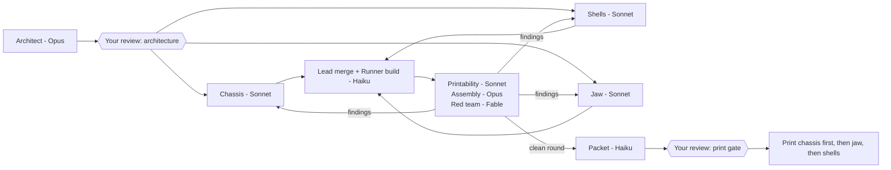

# Skull v2 plan

v2 is a redesign of the printed skull. It keeps the v1 electronics: eye bar and LCDs, servo, ESP32, radar, and the stand interface.

Nothing starts until you say **approved**, and v1 gets finished first.

## Goals

| # | Goal | What v1 did |
|---|---|---|
| 1 | No seam visible from the front | The face/cap cut runs across the forehead |
| 2 | Print-aware design: every part has a flat bed face and needs little support | The servo tray failed on a flat platform over support. Two jaw prints lost tree trunks. The cap's hook was the only thing touching the bed. |
| 3 | Modular: a central chassis plus a shell, each reprintable on its own | The chassis is built into the face, so a cosmetic fix means a 7 h reprint |
| 5 | Wiring designed with the parts: every cable checked at its real length, connector by connector, from the pin it starts at to where it plugs in | The ESP32 tray put the board where the 10 cm LCD leads couldn't reach the eyes, especially from the rear header row |
| 4 | Assembly designed first: servo-to-jaw screws reachable with a real screwdriver; the jaw has a planned way in | The horn screws were hard to reach, and the jaw-stop block blocked the jaw going in |

## Architecture

```
            stand
              │ (neck bolt)
        ┌─────┴─────┐
        │  CHASSIS  │  structural spine, prints fast, all inserts live here
        │ eye bar · servo · ESP32 · radar · jaw pivot · stops │
        └─┬───────┬─┘
          │       │ screws into chassis inserts
     FACE SHELL  CRANIUM SHELL      JAW
     (front,     (top + back,       (on servo horn
      cosmetic)   wraps over brow)   + chassis pivot)
```

- **The chassis is the default home for hardware.** This is guidance, not a rule.
  - The aim is short reprints and fast iteration: anything that's likely to change goes on the small, quick part.
  - It mounts on the stand, is open-frame and prints flat in roughly 2–3 h. If an internal mount is wrong, you reprint only the chassis.
  - A part goes elsewhere when its function needs it. Each exception is listed in the architecture doc with the reason:
    - **Radar:** stays in the nose, behind the thin nasal window in the face shell. The face shell carries its pocket. That's a small, simple feature, and the window has to be part of the visible surface.
    - **Servo and jaw:** the servo drives the jaw directly. Its position is fixed by the hinge axis and the horn-to-jaw joint, not by the chassis layout. The servo mount, horn and jaw are designed as one mechanism. The servo can sit on the chassis only where that also suits the jaw.
- **The shells are mostly cosmetic skins.**
  - Each shell attaches to the chassis. A shell carries hardware only where it's listed as an exception above.
  - The face shell is the whole front: brow, eye sockets, nose, cheekbones, upper teeth. The liners stay as glue-in inserts.
  - The cranium shell wraps over the top and back and meets the face behind the brow.
- **Seam placement:** the one hard constraint is that no seam shows when you look straight at the face from the front.
  - Beyond that, seams go wherever the print and joint rules work best: flat bed faces, overlaps that print vertically.
  - Following an anatomical line such as the coronal suture is a bonus if it costs nothing, never a reason to give up printability.
  - The architect shows the seam lines in a front-view render before any coding.
- **Assembly order:** stand → chassis → electronics → servo and jaw → stops → shells last.
  - The servo-to-jaw screws are driven while the chassis is still open on all sides, so there's no reaching through a socket.
  - If the jaw stops get in the way of fitting the jaw, they become a separate bolt-on piece that goes on after the jaw.

## Print rules (design inputs, not just checks)

Every part is designed in its print pose from the start. The build **fails** if a part breaks any of these rules:

1. **Bed contact:** a flat bed face of at least 500 mm², or at least 30 % of the part's footprint, whichever is smaller. Nothing hangs below it, whether a hook, a lip or a foot.
2. **No supported platforms:** no flat downward face larger than 15 × 15 mm sits on support.
3. **Overhangs:** these follow Bambu Studio's support **threshold angle**. Bambu measures it from horizontal, and any face flatter than the threshold gets support. The default is 35°.
   - The design is checked against 40°: every downward face meant to print unsupported is at least 40° from horizontal, which is at most 50° from vertical.
   - The slicer threshold then stays between 35° and 40° and is never set higher.
   - Chamfers and joint roots use 45° for margin. Where support is unavoidable it is listed per part, it must be reachable once printed, and it is printed with the Support for PLA interface.
4. **Tall supports:** none taller than 40 mm. Those are the ones that got knocked over on the jaw.
5. **Splits over supports:** a part is split rather than given a large overhang, if it can be glued or screwed back together.
6. **Hole orientation:** horizontal holes are teardrops.
7. **Inserts:** every insert boss stands vertical in its part's print pose.
8. **Joints:** no joint feature below a part's bed face. Every seam has an overlap; see Joints below.

## Wiring

- **Wires measured first:** the architect records every lead's real length and connector: LCD leads (10 cm DuPont, pin to pin), servo, radar and USB.
- **Board placement follows the wires:** the ESP32 goes where every lead reaches its device with 15–20 mm of slack, taking the header row and pin order into account. Fitting the wires to a board position is the wrong way round.
- **Routes are modelled:** each lead is routed as a swept tube at its real length and bend radius, from its pin to its device. The build fails if a route is longer than the lead or hits a part.
- **Plug-in order:** the assembly sequence says when each lead is plugged in, and the hand room needed to do it. If the board has to be plugged in before it is mounted, the mount has to allow that.
- **Fallback:** if a good board position needs longer leads, the BOM lists extension jumpers, and the architect flags it to you.

The assembly validator (Opus) also checks the wiring.

## Joints between large parts

Each joint is designed together with both parts' print poses. A joint feature is never added after the parts are designed.

1. **Joint features grow upward.** A locating feature goes on whichever part prints it as upward growth from that part's top or sides. It never goes below a bed face.
   - v1's cap hook hung below the cap's cut face, so the rest of the cap rim sat off the bed and the print failed.
   - The fix was to remove it. Building the hook up from the face's top cut would have worked too.
2. **Every seam overlaps.** A screw clamps a joint, but an overlap is what locates it.
   - Every seam needs a tongue, lip or rebate that slips into the other part along its length. v1's back cover had a screw at the back, but nothing at the temples guided the sides into the face.
   - Example: an inner edge on the cranium shell's side walls that slides inside the face shell, as a friction fit.
3. **The tongue goes on the part that prints it vertically.** For each seam, the architect states which part carries the tongue and confirms it prints as a vertical wall in that part's pose, with no overhang and nothing below the bed.
   - If neither part can carry a continuous tongue without breaking the print rules, the seam uses short tabs instead, or the split line moves.
4. **Fit:** a tongue is a slip fit, about 0.2–0.3 mm clearance per side, tunable per seam.
   - Screws do the clamping, and the overlap only locates.
   - The architect specifies a 30 mm test coupon for each fit, printed before the first large part.
5. **Assembly order:** the order of the overlaps sets the assembly order. Each part must be able to slide onto its tongue along its insertion move, which the assembly check verifies.
6. **Self-supporting profiles.** Every tongue, lip, tab and boss joins its wall at 45° or steeper, like a chamfered root or a gusset. Its tips taper, so no part of it needs support.
   - No block juts out from a wall with a flat underside. v1's ledges and pad blocks had flat undersides that needed support.
   - Where a shell wall leans out, the tongue follows the wall's line, or grows from it on a 45° chamfer. It never steps out horizontally.
   - Tapered tongues also lead the parts together during assembly.

Print rule 8 (added to the list above): no joint feature below a part's bed face. Every seam lists its overlap and which part carries it.

## Assembly and tool-access check (replaces v1's tool check)

The v1 check modelled a 100 mm straight tool and passed joints that are hard to reach by hand.

v2 models **your own drivers**. They are L-shaped hex keys for M2–M5: a long arm of about 50 mm, and a short arm of 20–30 mm that you hold as the handle.

Screws driven from the **outside** of a part are the default. A screw driven from inside needs a written reason in the architecture doc.

The check models the key both ways round:
- **Long arm in the screw:** 50 mm reach. The short arm swings in a circle of 20–30 mm radius around the screw axis, and needs at least 60° of clear swing so you can re-grip on the hex.
- **Short arm in the screw:** about 25 mm reach. The long arm swings in a circle of 50 mm radius, again needing at least 60°. Use this way for a screw where the reach is short.

A screw passes if either way works. The check:

- sweeps each screw's key at the assembly step where that screw is driven;
- **checks room for your hand, not just the key.** A key that fits with no room for your fingers fails. The hand is modelled as:
  - a pinch grip: a Ø25 mm cylinder around the arm you hold, over its full length plus 15 mm past its end;
  - a knuckle and palm block, 45 × 60 × 30 mm, behind the grip;
  - both swept through the same 60° turn as the key.

  Every screw needs this clear at its step. These are starting numbers, and the 30 mm test coupons can include a mock-up to check them against your hand;
- for each part, checks that its insertion path is collision-free at its step, as an explicit list of moves (for example "jaw: in from below, rotate 20°, onto the horn");
- renders each step with the driver in place, for the review packet.

## Team

The model is chosen per role: Haiku runs and renders, Sonnet codes, Opus and Fable reason and review.

| Role | Model | Count | Work |
|---|---|---|---|
| Lead / integrator | Opus (main chat) | 1 | Briefs, merges, rulings, talking to you. Writes no code. |
| **Architect** | Opus | 1, first | Writes `docs/skull-v2-architecture.md`: part list, seam lines, chassis interfaces (datums and insert positions), print pose per part, assembly sequence with insertion moves, rough renders of the seams. **Your review gate before any code.** |
| **Builders** | Sonnet | 3 in parallel (worktrees) | One each: **chassis**, **shells** (face + cranium), **jaw** (jaw, stops, horn interface). Each codes its own module against the architect's interface file. |
| **Runner** | Haiku | as needed | Runs builds, renders, the viewer and printability reports, and collects numbers. Builders hand it the long, log-heavy runs so their own context stays small. |
| **Printability validator** | Sonnet | 1 per round | Applies the print rules above to the build output. The rules are mechanical, so Sonnet is enough. |
| **Assembly validator** | Opus | 1 per round | Driver sweeps, insertion paths, jaw motion and stops, ±0.3 mm tolerance runs. Needs spatial reasoning. |
| **Red team** | Fable | 1 per round | Looks at renders and the viewer, not the code, and walks through building and printing the skull in its head. A different model family from the designers, so it doesn't share their blind spots. |
| **Packet** | Haiku | 1 | Assembles `REVIEW.md` from a template: renders, tables, validator results. |

**Rules:**
- **Shared rules:** every architect, builder and validator brief tells the agent to load the `/3d-print-design` skill first. The print and joint rules are then the same everywhere.
- **Escalation:** CSG debugging is the hard part of this work. If a Sonnet builder fails to fix a geometry problem in two tries, the lead re-briefs that piece to Opus rather than letting Sonnet keep going.
- **Validators** start fresh every round and never edit geometry.
- **Context:** each agent hands off with `HANDOFF.md` and restarts at about 300k context.
- **Concurrency:** at most 3 heavy builds at once, because each peaks at about 5 GB RAM.

## Order



The chassis gets printed and fitted with the electronics before any shell is printed. A chassis mistake then costs about 2 h of printing, not the face's 7 h.

## Reuse from v1

- Scan mesh and the voxel shell code (`vox.py`), the liners (`liners.py`), `printability.py` (extended with the rules above), and the electronics envelopes and datums.
- New code goes in `hardware/skull_v2/`, already split into modules (common, chassis, shells, jaw, interfaces, checks). v1 stays buildable as it is.

## Open questions for you

1. **Shell fixing:** should the shells screw to the chassis with inserts (sturdy, more screws), or use loose-fit pegs plus one screw each, as the v1 covers did?
2. **Start:** after Halloween, or should the architect start now, in parallel with the v1 finish?
