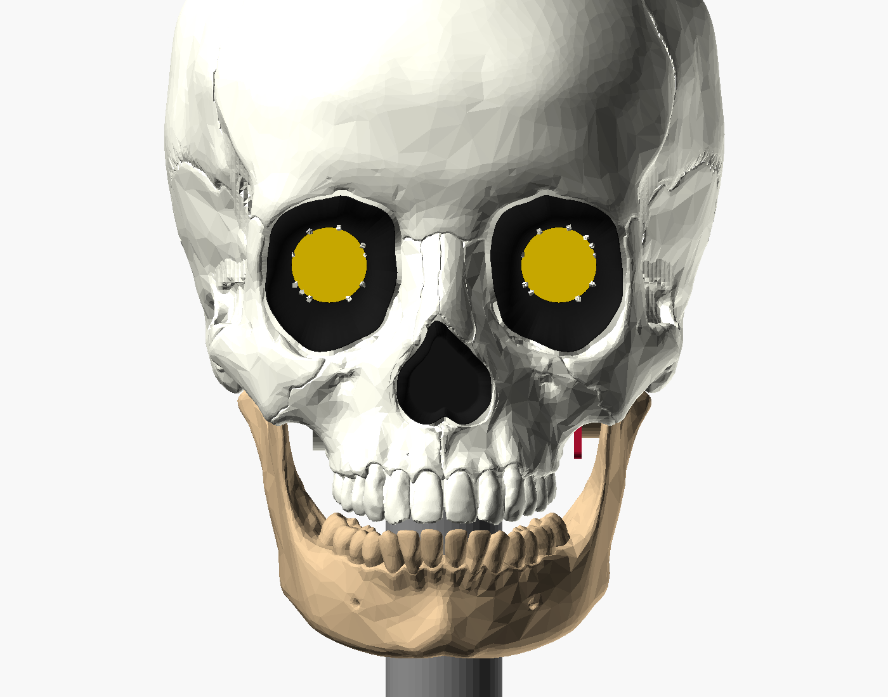

# Printable skull

An animatronic skull built from Peter from Belgium's CC0 anatomical skull
(Printables 2770). It prints in three skull parts, plus the jaw, the stand,
the servo bracket and the ESP32 tray:

- **chassis**: face, orbits, cranial floor, hinge and neck;
- **back cover**: behind the eyes, above the floor;
- **cap**: the calvaria.

Every electronic part and the jaw mount on the chassis.
- **Taking the back cover off** opens the space right behind the eye bar
  horizontally.
- **Taking the cap off** opens the whole top.
- The covers sit on lips or on the cut and take **one screw each**.

Everything comes from `build.py` and is reproducible.



| Preview | |
|---|---|
| `skull_front.png`, `skull_iso.png`, `skull_side.png` | assembled, on the stand; socket and nose liners black, screens gold |
| `skull_jaw_open.png` | jaw at the full 18° opening |
| `skull_exploded.png` | parts pulled apart in assembly order |
| `skull_bottom.png` | underside (servo cup, pivot boss, neck boss) |
| `skull_chassis_from_behind.png`, `skull_chassis_from_behind_34.png` | the chassis with both covers off, from behind: eye bar fitted, the eye screws' tool paths (blue) and the hand space round the screwdriver handle (orange) |
| `skull_chassis_from_above.png` | the same from above with the electronics fitted, and the tool paths for the screws driven from the top |
| `skull_chassis_34_hw.png` | the chassis with everything fitted, covers off |
| `skull_covers.png` | the back cover and the cap (cap lifted 60 mm) |
| `skull_cover_joints.png` | sections through the cover joints: the cap's front resting on the cut; the back cover screw and the cap screw; the floor lip |
| `out/closeup_back_cover_screw.png`, `out/closeup_cap_screw.png` | sections through the two cover screws: screw (red), head, insert (gold) in its bore |
| `out/closeup_jaw_horn_pad.png`, `out/closeup_jaw_pivot.png` | sections through the jaw attachments: servo-side knuckle and horn screws, pivot knuckle and bolt |
| `out/closeup_jaw_pivot_34.png`, `out/closeup_jaw_horn_34.png` (+ `_inside`) | each half of the jaw on its own, 3/4 view from outside (and from inside): the knuckles |
| `skull_stand_cable.png` | USB cable path: neck bore, then the stand column and its open slot |
| `out/skull_servo_tray_print.png` | the old one-part servo tray and the new servo bracket + ESP32 tray in print orientation, from above and below; faces that need support red, bridges orange |
| `out/skull_esp32_usb.png` | the servo bracket, ESP32 tray and ESP32, cap off: DuPont housings + wires, USB plug, insertion path, grip, cable loop into the neck bore, EN/BOOT fingertips |
| `skull_section_orbits.png` | sections through the orbit centres and through one eye (socket bowls, modules, bar) |
| `skull_section_jaw.png` | sections through the servo/neck and along the hinge axis |

## Build

```sh
cd hardware
python3 -m venv .venv && .venv/bin/pip install -r skull/requirements.txt
.venv/bin/python skull/build.py          # ~2.5 min; --no-render skips the PNGs
```

The script needs the source meshes, which are git-ignored because they are
65 MB. Download them from the links in `skull_src/*/LICENSE.txt` into the
same folders:

- `peter_belgium_2770/skull_mesh.stl`
- `peter_belgium_2770/skull_w_jaw.stl`
- `gage_recut_293680/jaw_top.stl`
- `gage_recut_293680/jaw_lower.stl`

The renders use the OpenSCAD CLI (`/Applications/OpenSCAD.app`). The script
writes `out/*.stl` (already in print orientation) and
`out/build_report.json` (measurements and checks), and caches the source
union in `cache/`.

## What the pipeline does

1. **Sources.** It unions the 35 watertight cranium shells into one solid,
   dropping zero-volume slivers. It unions `jaw_top` + `jaw_lower` and moves
   them into the articulated pose by an ICP fit onto the jaw inside
   `skull_w_jaw.stl`. It then rotates the jaw about the condyle axis until the
   teeth are `TEETH_GAP` (0.8 mm) apart. That is 9° more closed than Peter's
   pose, which has the mouth slightly open.
2. **Scale.** The orbit opening is the iso-depth contour (seen from the front)
   through the lateral orbital rim crest. It follows the medial, superior and
   inferior margins. The centre is the midpoint of the opening's breadth and
   height. The centres measure **59.0 mm** apart in the source, so the scale is
   **0.932×**. The origin is the midpoint between the orbits: Y = 0 is the
   median rim depth, the face looks toward −Y, and +Z is up (2 mm above the
   orbit centres, `EYE_DZ`).
3. **Eye sockets and nose.** Each is a smooth bowl lofted analytically in
   manifold3d (not voxels). It starts at the measured rim outline, runs
   straight back, then curves in (a quarter-ellipse profile per angle).
   - Eyes: each bowl ends in a flat bezel with a Ø18.5 opening. The glass sits
     **15 mm behind the rim plane**.
   - Nose: the bowl ends in a flat 1.8 mm window 6 mm behind the piriform rim.
     The radar looks through it.
4. **Clean shell.** The skull is voxelised at 0.5 mm.
   - The bowls seal the eyes and nose.
   - Recessed webs (3.5 mm behind the bridged surface) close gaps narrower
     than about 14 mm everywhere, 30 mm on the base and 44 mm round the
     zygomatic arches. That covers round the jaw hinge, the foramen magnum and
     the other base openings.
   - The temporal fossae above the arches are filled flush (a closing of 30 mm
     radius), giving full, smooth temples like a prop skull. This is also what
     makes room behind the eyes.
   - The jaw's swept volume is carved out.
   - Everything behind the eyes is sealed at the outer hull (`BEHIND_EYES`),
     and a wall closes the back of the nasal cavity (`CHOANA`). Without these,
     outside air reached in beside the arches and through the throat, and the
     shell lined that air with walls. Those walls formed a plate behind the
     eyes that blocked assembly. The build now asserts that the space behind
     the eyes and the nasal cavity are inside.
   - The script then flood-fills the outside air and keeps a uniform
     **2.6 mm** shell under everything you can see. Internal anatomy
     (sphenoid, conchae, orbit walls, cranial base interior) disappears.
   - The build fails if the brain cavity can be reached from outside.
   - The visible bone surface is Peter's original mesh. Web and inner surfaces
     are marching cubes on a smoothed distance field. The bowls are then cut
     in exactly, so their visible surfaces are smooth.
5. **Parts and features**: split, posts, joints, servo, pivot, servo bracket, ESP32 tray, neck. See
   below.
6. **Checks.** Every STL is re-read after export: each must be watertight and
   a single body. No two placed parts may overlap by more than 0.005 cm³:
   the face, back, jaw, eye bar, eye modules, servo, servo bracket, ESP32 tray, ESP32 + pin
   headers + DuPont housings, radar, stand and joint brackets. The jaw is swept from the
   closed stop to the open stop in 1° steps against the face, back, servo,
   servo bracket, ESP32 tray and stand. The joint brackets are slid on along Y to check that the
   back part can be fitted. Every clearance cut (modules, bar, cables, screw
   access, radar) must stay inside the skull's closed envelope, so none of
   them opens a hole in the surface.
   - **Assembly paths, tool access and cover fitting** are checked too (see
     *Tool access* below).
   - **ESP32, USB and DuPont keep-outs** (see *Electronics*).
   - **Fasteners** (every screw, assembled): the head seat is found where
     the head first touches the clamped part and must bear on a flat ring;
     the clearance hole is empty from the seat to the joint face; an insert
     has an empty Ø4.0 × 6.7 bore from the joint face with at least 1.6 mm
     of wall round it; the tip has room past the bore; and the screw
     engages at least 4 mm of insert (self-tapping screws must pass right
     through a thin part). See *Fasteners*.
   - The current build reports no collisions, a clear jaw sweep, and stops
     that engage 1.5° past each end.

## Size

Assembled skull: **134 W × 184 L × 162 H mm** (cranium), about 205 mm tall
with the jaw. The stand adds 78 mm.

## Parts

| STL (`out/`) | Size (mm, x × y × z) | Volume | Print orientation | Supports | Time (rough) |
|---|---|---|---|---|---|
| `face.stl` (chassis) | 115 × 171 × 95 | 129 cm³ | upright, as in the skull | yes: under the cranial floor, inside the socket bowls (their tops), under the posts and pivot boss | ~7 h |
| `back.stl` (back cover) | 134 × 124 × 50 | 40 cm³ | lower cut (z = −14) on the bed | none to little | ~2 h |
| `cap.stl` | 134 × 172 × 70 | 94 cm³ | cut face on the bed (whole rim flat on the bed), crown up | inside the dome (see below) | ~4 h |
| `jaw.stl` | 99 × 97 × 74 | 57 cm³ | upright | tree under the lower border and the two hinge knuckles | ~2 h |
| `stand.stl` | Ø110 × 88 | 114 cm³ | base on the bed | none (the cable slot is open) | ~3 h |
| `servo_bracket.stl` | 40 × 18 × 27 | 3.1 cm³ | servo plate's outer face on the bed (flange and gussets stand up) | none | ~15 min |
| `esp32_tray.stl` | 72 × 43 × 35 | 15.4 cm³ | upright, base on the bed | none | ~50 min |

Times are estimates for a Bambu H2D with PLA at 0.2 mm (about 10 mm³/s
average plus support overhead). Check them in Bambu Studio. Everything fits
the H2D bed.

- The chassis has two cut faces at right angles (behind the eyes, and the
  floor), so it can't lie on a cut. Upright needs supports under the base
  and inside the upper half of each socket bowl.
- The back cover and the cap print on their flat cuts.
- The servo bracket and the ESP32 tray print together on one plate, with
  supports off. Neither has a downward face steeper than 45° or a bridge
  (the build checks this, below). The flange bolt holes in the bracket are
  horizontal as printed, so they are teardrops pointing up; the zip-tie hole
  in the tray is a teardrop too.

**Printability check** (`printability.py`, `printability` in the report). For
every part except the face (already printed), in its print orientation, the
build measures the downward-facing area steeper than 45° from vertical (not
counting the bed), which of it is a bridge (a flat ceiling held on two
opposite sides; its span), and the rest, which needs support. It fails if the
servo bracket or the ESP32 tray needs more than 50 mm² of support or has a
bridge over 10 mm; the other parts are reported only. This build:

| Part | Needs support | Bridges (longest) | Bed contact | Note |
|---|---|---|---|---|
| `servo_bracket.stl` | 0.5 mm² | none | 392 mm² | fails above 50 mm² / 10 mm |
| `esp32_tray.stl` | 0 | none | 1,747 mm² | fails above 50 mm² / 10 mm |
| `back.stl` | ~680 mm² | 18 mm² (2 mm) | 1,022 mm² | not yet printed |
| `cap.stl` | ~10,260 mm² | 555 mm² (1.4 mm) | 1,318 mm² | whole cut rim on the bed (no hook) |
| `jaw.stl` | ~1,180 mm² | 59 mm² (2 mm) | 0 | not yet printed |
| `stand.stl` | 10 mm² | 2 mm² (1.9 mm) | 8,873 mm² | not yet printed |
| `liner_*.stl` | 18 mm² each | ~1 mm² | 170–230 mm² | already printed; the 45° outside meshes a hair past the limit |

Unprinted parts: the jaw has no flat face on the bed (it stands on the chin
and teeth), so it needs supports and a brim as before. The cap prints cut
face down with its whole rim (about 1,300 mm²) on the bed; nothing on it
stands below the rim any more. The inside of the dome is over air: its upper inside surface
(about 10,260 mm²) needs support; consider printing it
crown down on supports instead, or accept tree supports inside. The back
cover needs support under its inside top edge and the screw pad.

The face is checked the other way: it is already printed, so the build fails
unless `out/face.stl` is byte-identical to main's (9c237b9), or failing that
the same solid by volume (`face_check` in the report).

**Settings:** PLA (PETG if it will sit in sun or heat). 0.2 mm layers;
0.16 mm on the face for the teeth if you like. 4 walls, 25 % gyroid. Tree
supports (auto), threshold 30°. The chassis needs supports *everywhere*,
because the bowls are inside. Brim on the jaw.
The minimum designed wall is 1.6 mm. The shell is 2.6 mm, the socket bowls
2.0 mm and the nasal window 1.8 mm.

### Black liners (eye sockets and nose)

The socket bowls and the nose bowl are three separate black parts that sit in
the face, so nothing needs painting and the face prints in one colour
(`liners.py`, called from `build.py` once the face is finished).

- **Shape.** Each liner's inside is the analytic bowl that `build.py` lofts
  for the socket, so the visible cavity keeps its shape and size. The face is
  cut back by the liner plus a loose gap and gets a new 2 mm wall behind the
  pocket (1.2 mm behind the pocket's base), tied into the bone by a collar
  round the rim.
  - Liner wall 1.2 mm (measured square to the bowl); 0.3 mm gap to the face
    round the bowl and behind the base.
  - **Rim lip:** 0.6 mm thick and 1 mm wide past the wall. It laps over the
    face into a matching rebate and sits flush, with 0.3 mm round its edge.
    Under the lip a 45° chamfer is the seat, 0.05 mm off its pocket, so the
    lip ends flush (at most 0.07 mm proud) and the liner centres itself.
  - Where bone stands in front of the rim (a raised margin round part of each
    socket and the top of the nose), that bone hides the seam, so the lip
    narrows to nothing there instead of the rebate shaving the bone thin.
  - The lip follows the face surface, but never slopes back more than 45°;
    where the bone falls away faster (lower outer orbit), the lip stands just
    proud of it.
  - **Eyes:** the liner's flat back is the screen bezel: Ø18.5 aperture,
    14.25 mm behind the rim plane, 0.75 mm in front of the glass (the same
    clearance the eye-bar path keeps). Behind it the face is open round the
    module.
  - **Nose:** the liner's flat bottom is the 1.8 mm radar window. Use a black
    PLA without carbon fibre or metal fill there, and check the radar range
    with the liner fitted.
- **Retention: a glue dab.** A liner goes in from the front and the face
  only holds it from behind; nothing can hold it from the front without a
  part that would block it going in, so the eye bar cannot clamp it. Put
  2–3 small dabs of CA or hot glue on the chamfer seat (or, for the eyes,
  through the open back round the screen, before the eye bar goes in), push
  the liner home and hold it for a few seconds. Hot glue comes off again.
- **Print:** back face (bezel ring or radar window) on the bed, opening up.
  The outside is a 45° self-supporting envelope, so no supports, and the
  visible inside prints as top surface. A 3 mm brim helps the eye liners,
  whose bed contact is a ring. Black PLA, 0.2 mm, 3 walls (the wall is all
  perimeter).

| STL (`out/`) | Size (mm, as printed) | Volume | Time (rough) |
|---|---|---|---|
| `liner_eye_L.stl` | 35 × 40 × 26 | 2.5 cm³ | ~30 min |
| `liner_eye_R.stl` | 36 × 40 × 26 | 2.5 cm³ | ~30 min |
| `liner_nose.stl` | 28 × 29 × 28 | 2.0 cm³ | ~25 min |

All three fit one plate: about 1 h 15 min together on an H2D.

`out/skull_face_liners.png` shows the face with the liners fitted (front and
3/4) and pulled 30 mm forward.

**Checks** (in `build_report.json` under `info.liners`; the build fails on
any of them):
- the liners overlap nothing: face, eye modules, eye bar, radar, the eye-bar
  insertion path and the radar path;
- liner wall ≥ 0.8 mm (rays square into the wall from area-weighted points;
  the lip is reported apart: 0.6 mm by design);
- face wall behind the liner pockets: the target is 1.2 mm (samples under it
  are counted in the report) and the build fails under 0.9 mm. The first
  2.5 mm below the rim (rebate, seat and the slot beside the lip) is reported
  apart as the rim zone: where the bone falls away steeply or stands thin in
  front of the rim, the face's rim edge runs out to a feather edge there, as
  the bone itself does;
- no line of sight past a liner into the skull (4,000 rays per socket,
  up to 45° off axis). Rays that reach a little way down the 0.3 mm seam where
  the lip narrows are counted and reported, not failed.

The eye-bar tool access, hand space and collision checks run on the new face
as before.

The booleans of these finely sampled surfaces leave a few hundred vertices
microns apart, which pinch edges once the mesh is written as float32 STL.
`liners.py` fills each with a 0.3 mm cube (union only, inside the 0.3 mm
gap), so every STL is watertight; the thickness checks measure the geometry
before that fill.

## Mechanism

### Eyes
- **Glass face: 15.0 mm behind the orbit rim plane** (`EYE_DEPTH`).
  - Each socket is a smooth black bowl from the rim outline down to a flat
    2 mm bezel with a Ø18.5 opening (the active circle is 18 mm). The glass
    sits 0.6 mm behind it.
  - I tried 12–18 mm. At 16 mm and deeper the module or bar clearance breaks
    through the skull wall just behind the lower outer orbit, so 15 is the
    deepest clean value.
  - The eyes sit 2 mm above the measured orbit centres (`EYE_DZ`) for the
    same reason. That also helps the look.
- **The eye bar is `../eye_mount.scad` (`mount_style = "skull"`).** Each
  module is turned 90° so its tip points at the nose.
  - Even with the filled temples, the outer M2 screws of the unrotated layout
    (x = ±35.4) would break through the temple wall at the bar's depth
    (y = 21–27). **The firmware has to rotate the picture 90°.**
  - The bar plate is ±10.4 mm tall with its lower outer corners chamfered
    by 1 mm. That corner of the skull is the tightest spot. (A 4 mm chamfer
    cut through the lower M2 holes; the heads only bore on about half their
    ring.)
- Behind the bowls, everything is cleared with 0.75 mm round it: the
  modules, the bar, the M2 heads, the connectors and their cables (a 16 mm
  channel behind each window), and screwdriver access to the bar bolts.
- The bar back face is at Y = 26.85, 5 mm in front of the back cut.
  - The bar bolt and the four M2 module screws are driven straight from
    behind, through the back opening.
  - There is a 60 × 40 mm hand space round the screwdriver handle, from 60 mm
    behind the screw.
- **Fitting the bar:** with both LCDs and their cables attached, it comes in
  through the back opening. It moves 12 mm forward onto the posts
  (`EYE_BAR_BACKOFF`), and before that can come straight down from the top.
  The path is checked clear of the chassis.
- **One bolt.** The left post has an M3 insert. The right post has a printed
  Ø3 key peg that sits in the bar's other slot, so the bar can't rotate.
  - The slots are Ø3.6 with 3 mm vertical travel, so you can still centre the
    screens in the bezels.
  - There is no centre post. That keeps the slot between the bowls free for
    the radar to go in.

### Jaw: direct drive
- The hinge axis is the condyle axis (Y = 65.1, Z = −29.4 in the eye frame), parallel to X.
- **The face part is the chassis.** The servo cup, the servo-bracket bosses
  and the jaw pivot boss are all part of the face. The jaw hangs from the
  chassis.
  - Jaw load path: jaw → horn and pivot bolt → servo bracket and pivot boss →
    the face's cranial base → the neck boss → the stand.
  - The face's cranial base is the skull's own base and sides, the stiffest
    part of the skull.
- An MG90S sits in a closed cup in the cranial floor on the +X side, its
  output shaft on the hinge axis. The cup is part of the shell, so nothing
  inside is visible.
- The servo screws (tab screws) onto the **servo bracket**, an L-bracket.
  Its flange drops in from inside and bolts down onto two insert bosses
  (M3×12, vertical), through the foot of the ESP32 tray lying on it (see
  *Electronics*). Two gussets fill the corner between the flange and the
  servo plate beside the servo case.
- The horn (single or double arm, pointing down the ramus) is screwed to the
  spline on the bench.
  - The jaw then fixes to the horn with two M2×16 self-tapping screws from
    **outside** the ramus. They go through Ø2.2 pilots at 10 and 14 mm from
    the axis along the horn arm, which points 20° forward of straight down,
    along the condyle neck (`HORN_ARM_DEG`). The heads sit on a shallow Ø6
    spot face on the outer end of the knuckle (|x| = 45.8); each screw has
    3.2 mm past the joint face, i.e. it just passes through the horn arm.
  - Screwing from outside is the only straight tool path once the jaw is
    on.
- **Knuckles.** Each condyle neck carries a knuckle on its inside, grown out
  of the bone (`jaw_pads()`, `JAW_PAD`, `PIVOT_PAD`):
  - Outline seen along the axis: a teardrop, the hull of a disc on the axis
    (Ø19 pivot side, Ø16 servo side) and an Ø14 disc 16 mm down the condyle
    neck (20° forward of straight down, along the horn arm).
  - Inside the outline the jaw is solid from the pad face out to 0.8 mm under
    the ramus' outer skin, and at least 13 mm (servo side) / 14 mm (pivot
    side) thick where there is no ramus outside it. A 4 mm fillet (a
    Euclidean closing) blends it into the ramus.
  - Above the condyle trim only the axis disc is kept: it turns in place, so
    it sweeps only itself. It runs from the pad face out to |x| = 47 (servo)
    and 48.5 (pivot) as a solid boss round the axis.
  - Pivot side: 7.75 mm of wall round the Ø3.5 bolt hole and 6.2 mm round the
    Ø6.6 head counterbore (was 5.75 and 4.2 with a Ø22 × 8 disc and a Ø15
    boss). The knuckle's section is 500 mm² at the pad face and 670–850 mm²
    where it joins the ramus (was 310 mm² throughout the disc).
  - Servo side: 6.7 / 6.1 mm round the r = 10 / 14 horn-screw pilots (was
    4.3 and 2.45 mm at the r = 14 screw), and 6 mm over the axis hole, which
    is now an Ø7 × 4 counterbore for the horn-screw head, then Ø5 through
    for a driver (the Ø7 used to run through, opened at the top by the trim).
  - Nothing of the condyles stays inboard of the pad faces.
- **Pivot boss on the skull:** Ø30 round the insert (13 mm of wall), rooted in
  the cranial floor by a gusset that flares from the boss top out over the
  floor (y ± 17, out to |x| = 14), kept inside the skin and below the chassis
  cut.
- The build checks all of this (`jaw_check()`; it fails below 4 mm of wall
  round any jaw hole, 2.5 mm round the pivot insert, or 1.0 mm of clearance
  between the knuckle tops and the skull over the sweep).
- The other side pivots on an **M3×20** shoulder of the bolt. The head sits
  in a counterbore on the outside of the condyle, and the bolt runs into an
  insert in a boss hanging from the skull base, with a 0.5 mm gap. Add a
  washer.
- **Range: 0 to 18° nominal** (JAW_OPEN_DEG). That gives about 33 mm of chin
  travel, which reads clearly for a talking skull; 15–20° is the usual prop
  range. Set the servo limits in firmware.
- Hard stops: a finger on the pivot-side knuckle runs in a slot in the skull
  boss and stops at −0.5° (teeth just clear; checked) and +20°.
- The condyle heads are trimmed 3.5 mm above the axis.
- The cranium is carved 1.2 mm clear of the jaw swept from −1.5° to +21.5°,
  and the shell wraps the carve, so the hinge region stays closed. Round the
  condyles (|x| ≥ 24) the carve is a true distance, 1.2 + 1.4 mm
  (`HINGE_CLEAR_EXTRA`, lost again to voxels and smoothing), which leaves the
  knuckle tops at least 1 mm clear.
- Why direct drive works here: the hinge sits right at the level of the skull
  base. A vertical servo body (22.8 mm) fits mostly inside the cranium, with
  the cup bulging about 15 mm below the base, hidden between the jaw rami.
  There are no linkages to set up.

### Chassis, back cover and cap
- **Cap cut:** the plane z = 32 − 0.04·(y + 5) (`SEAM`). That is just above
  the brow at the front and about 26 mm up at the back of the head.
- **Back cut:** y = 32 (`Y_BACK`, 5 mm behind the eye bar) from the cap cut
  down to z = −14 (`Z_FLOOR`). From there the cut runs horizontally back to
  the back of the head.
- **Chassis** (below the cap cut, and in front of y = 32 or below z = −14):
  - the face, socket bowls, nose and radar;
  - the cranial floor with the hinge, servo cup and jaw pivot;
  - the hollow neck.
- **Back cover:** the band of skull wall behind the eyes, from the floor cut
  up to the cap. It carries nothing.
- **Cap:** the calvaria. It carries nothing.
- With both covers off, nothing stands between the eye bar and the back of
  the head, and the top is open.

**Cover joints (no brackets):**
- **Back cover:**
  - It drops straight down onto the chassis floor.
  - Its lower edge goes outside a 5 mm lip on the chassis (0.5 mm
    clearance, 1.5 mm lead-in step). The lip is trimmed wherever the cover
    would brush it on the way down.
  - One M3×12 from behind, low at the back of the head (z = −9), goes
    through the cover into an insert post on the chassis.
  - The back of the head overhangs there, and the cover drops straight
    down, so the post face (y ≈ 139.5) must stay in front of all cover wall
    below it. The cover therefore has a Ø10 pad out to the post face (0.5 mm
    gap), and the slanted outside gets a Ø6.5 spot face so the head sits
    flat.
- **Cap:**
  - Fitting: lower it straight down onto the cut. Its front just rests on
    the cut; there is no hook (removed so the cap prints with its whole rim
    on the bed). The chassis still has the small forehead ledge it was
    printed with; nothing engages it.
  - It is held only by the back screw:
    one M3×12 from behind, high at the back of the head, goes through the
    cap into an insert boss on the back cover. The boss reaches up across the
    cap cut to the screw axis (6 mm above it), with a flat face square to the
    screw about 1 mm inside the cap wall. The back cover is then trapped
    under the cap, and screwed to the chassis at its bottom.
- **Checked:**
  - The back cover drops in with everything fitted.
  - The cap's straight-down path onto the cut is clear.
  - Nothing collides when fitted.

### Tool access (checked by the build; it fails on any problem)
- **Tool path.** For every screw, the build sweeps a straight tool along the
  screw axis outward from the head:
  - Ø8 × 100 mm, which is a driver shaft plus a hand;
  - Ø5.5 for the first 8 mm past any counterbore, which is the bit.

  The tool must not touch any part fitted at that point in the assembly
  order. Parts fitted later don't count.
- **Opening.** The tool must also leave through the opening that is meant to
  be open at that step:
  - `back` for the eye screws;
  - `top` for the two servo-bracket bolts;
  - `outside` for the jaw, cover and stand screws.

  The opening is where the tool path leaves the skull, or the last part
  region it is in.
- **Hand space.** The eye-bar bolt also needs a 60 × 40 × 50 mm empty hand
  space round the handle, from 60 mm behind the screw.
- **Result in this build:** all 16 screws OK (tool access and the fastener check), and the hand space is clear.
  The eye-bar insertion path and the radar path (on edge up the slot between
  the bowls) are clear too.

### Electronics
- **Servo bracket** (`servo_bracket.stl`) and **ESP32 tray**
  (`esp32_tray.stl`): two parts, both printed without support. (They were one
  part, `servo_tray.stl`, whose cradle printed as a flat platform on support
  and failed; see `out/skull_servo_tray_print.png`.)
  - The bracket drops in from above (cap and back cover off) with the servo
    already screwed to it and the horn on.
  - The tray then drops onto it. Its 3 mm foot lies on the bracket flange
    and the same two bolts, now **M3×12**, go through the foot and the flange
    into the face's two inserts. The tray needs no screws, inserts or
    chassis features of its own.
  - From the foot a 3 mm base plate (z −2.75 to 0.25, y 81.4–98.6) runs
    under the board out to its far end (x = −52.4). Two rails (2.4 mm, at
    y = 90 ± 7.4, i.e. *between* the two header rows, so the DuPont wires
    hang free outside them) stand on it; their top edges (z = 30) seat the
    board along its length.
  - Teeth on the rails stop the board ends (0.5 mm clear, 2 mm high). Past
    the USB end the rails step down to z = 26.6 under the plug's grip room,
    with a 45° chamfer behind the tooth.
  - An open notch (7 mm, from the +X edge) in the foot/base lets the USB
    cable pass down to the neck bore; between the rails, under the board,
    the cable runs back from the loop to the notch.
- **ESP32-DevKitC-VIE** (55 × 28, no mounting holes) lies flat, pins down,
  long axis along X, centred on the neck-bore line (y = 90): **x −49.5 to
  +5.5, PCB bottom z = 30**, USB end at +X. It sits on the rail tops between
  the end teeth, held by one zip tie under its far end, between the board
  edge and the first pin: over the board, down both long edges, and through
  the tie hole across both rails 3 mm under the board (a 2.8 × 1.8 teardrop,
  for a 2.5 mm tie). Cut the tie and the board lifts straight off without
  touching the servo or the tray bolts.
- **Power:** by USB cable from outside (a power bank or the laptop). There is
  no internal battery.
  - The micro-USB plug points +X at z = 33. The cable loops down (R 15) just
    past the boot, runs back at z = 3, bends down (R 15) onto the neck axis
    and enters the bore at its top (z = −12).
  - It then goes down the hollow neck (Ø14 bore, passes a USB-A plug), into
    the stand column, and out at the base.
  - **Checked by the build** (`usb/*` in the report; the build fails on any
    hit):
    - plug (overmold 11 × 8 × 20 + 10 mm boot) plugged in: clear of every
      part, covers on;
    - straight insertion path, 36 mm along the axis, and grip room (9 mm
      either side of the plug, up 30 mm through the open top), cap off;
    - cable (Ø4.5 + 0.5, bend radius 15) from the boot to the bore: clear of
      the chassis, covers, servo, servo bracket, ESP32 tray, horn sweep, jaw sweep and the
      stand; the back cover lifting off and the cap's fitting path don't
      catch the cable or the plug;
    - DuPont housings (2.6 × 14 per row) and their wires (out of the bottom,
      then 15 mm down and sideways) on both rows: clear of the bracket, tray, servo,
      chassis and covers;
    - EN and BOOT (4 mm in from the USB end, ±10 mm): an Ø8 fingertip column
      45 mm up is clear, cap off, plug in;
    - the servo bracket (with servo and horn) drops in from above, then the
      ESP32 tray onto it, and the ESP32 lifts out with both in place.
  - The old layout (board centred on x = 0 over a flat tray at z = −7) failed:
    the insertion path ran into the back cover (only ~3.5 mm past the boot
    to the wall, so no room to bend the cable), the tray plate covered the
    neck bore, and the DuPont wires had 2 mm under the housings and ran into
    the tray, the hook posts, the servo and its bracket.
  - A zip-tie arch on the chassis floor behind the neck (y = 114) gives
    strain relief.
- **HLK-LD2410C** (35 × 7 mm, no screws) lies horizontal and faces forward
  behind the **1.8 mm nasal window**: the flat bottom of the nose bowl, 6 mm
  behind the piriform rim.
  - It sits in a frame pocket (0.6 mm clearance), open at the back for the
    header and cable.
  - It goes in on edge down the slot between the bowls, then turns flat and
    slides forward.
  - Fix it with a dab of hot glue or tape. Antenna side to the window.

### Stand
- The neck boss is a Ø30 tube under the foramen magnum (Y = 90) with a Ø14
  bore into the skull.
  - It drops into a 10 mm socket on top of the stand column (0.4 mm
    clearance).
  - One M3×8 from behind (+Y) goes through the socket wall into an insert
    in the neck.
- The column is Ø38 with an Ø18 bore. An **open 8 mm slot** runs down its
  whole length (toward −X) and across the base, so the USB cable drops in
  sideways; no threading past the neck.

## Fasteners

**16 screws** in total (the two bracket bolts are now M3×12), down from 27 in the previous (bracketed) layout, and
**7 M3 inserts**, down from 17 plus one M5.

| Item | Qty | Where |
|---|---|---|
| M3 heat-set insert (5.7 long; Ø4.0 × 6.7 pilot bore, Ø3.2 relief past it) | 7 | eye-bar post, 2 servo-bracket bosses, jaw pivot boss, back-cover post (chassis), cap boss (back cover), neck |
| M3×12 | 5 | eye bar (+ Ø9 M3 washer, DIN 9021, over the slot), back cover, cap, 2 servo bracket (through the ESP32 tray foot) |
| M3×20 | 1 | jaw pivot (+ M3 washer) |
| M3×8 | 1 | stand (an M3×12 there would reach into the cable bore) |
| M2×8 | 4 | LCD modules to the eye bar |
| M2×16 self-tapping | 2 | jaw to horn arm, from outside the ramus |
| servo tab screws (supplied) | 2 | servo to the servo bracket |
| zip tie, 2.5 mm wide | 1 | ESP32 to the tray |
| horn screw (supplied) | 1 | horn to spline |

What changed:

| Joint | Before | Now |
|---|---|---|
| Joint brackets | 8 screws | gone; replaced by lips/the cut + 2 screws |
| Eye bar | 2 bolts | 1 bolt + a key peg |
| Tray | 4 bolts | clamped under the 2 servo-bracket bolts (M3×8 → M3×12): no screws of its own |
| Stand | M5 bolt | M3 radial screw |

The jaw and servo load path keeps its screws.

## Assembly

Everything goes onto the chassis. The back cover and then the cap go on last.

1. **Bench:**
   - Heat-set the inserts.
   - Screw the servo into the servo bracket (tab screws). Centre it and screw
     the horn on, pointing down the ramus.
2. **Liners** (before the eye bar): push each black liner into its socket
   from the front until the lip sits flush, with 2–3 dabs of glue on the
   seat (see *Black liners*).
3. **Eyes** (both covers off, chassis on the bench):
   - Plug the cables into the LCDs.
   - Bring the eye bar in from behind and push it onto the left post and the
     right key peg.
   - Screw the M2×8s and the M3×12 bar bolt (with a Ø9 washer) straight from
     behind. Centre the screens.
4. **Radar:** on edge down the slot between the bowls, then flat and forward
   into its frame.
5. **USB cable:** feed the USB-A end down the neck bore from inside and lay
   the cable in the stand slot later; leave the micro-USB end inside.
6. **Servo bracket, ESP32 tray, ESP32 and jaw:**
   - Lower the servo bracket (servo and horn on it) into the cup, with the
     gear tower down the slot in the cup wall.
   - Lay the USB cable from the neck bore out toward +X along y = 90, then
     lower the ESP32 tray onto the flange: the cable goes into the open notch
     and under the board between the rails. Bolt tray and bracket down
     together (2× M3×12 from above).
   - Set the ESP32 on the rails between the teeth, pins down with the DuPont
     leads on, and zip-tie its far end through the tie hole. Plug the
     micro-USB in, the cable looping down past the rail ends.
   - Fix the jaw to the horn with 2× M2×16 from outside the ramus.
   - Put the M3×20 pivot bolt (with a washer) through the other condyle.
   - Wire everything and test on the bench.
7. **Back cover:** drop it onto the floor lip, then fit 1× M3×12 from behind,
   low.
8. **Cap:**
   - Lower it 6 mm behind its place and slide it forward under the forehead
     ledge.
   - Fit 1× M3×12 from behind, high.
9. **Stand:**
   - Lay the cable (already down the neck bore) in the column slot.
   - Push the stand's socket onto the neck.
   - Fit 1× M3×8 from behind.

## Parameters you are likely to touch (top of `build.py`)

| Parameter | Default | Effect |
|---|---|---|
| `EYE_SPACING` | 55.0 | screen spacing, and so the overall scale |
| `EYE_DEPTH` | 15 | glass depth behind the rim plane (the bowl depth) |
| `SOCKET_WALL`, `SCREEN_GAP`, `APERTURE_D` | 2.0, 0.6, 18.5 | bowl wall, bezel to glass gap, bezel opening |
| `ORBIT_SHRINK` | 0 | pull the socket rim outline in (fraction) |
| `EYE_DZ` | 2 | eyes this far above the measured orbit centres |
| `STANDOFF_H`, `MODULE_T` | 3.0, 3.2 | **measure your modules**; they set the bar depth |
| `SHELL_T` | 2.6 | wall thickness |
| `WEB_CLOSE_R`, `BASE_CLOSE_R`, `TEMPLE_CLOSE_R`, `WEB_RECESS` | 7, 15, 22, 3.5 | how big a gap gets webbed, and how deep the web sits |
| `FOSSA_CLOSE_R`, `FOSSA_RECESS` | 30, 0 | temple fill (flush) |
| `SMOOTH_SIGMA`, `MC_SIGMA` | 1.5, 1.2 | smoothing of web and inner surfaces |
| `NASAL_RECESS`, `NASAL_T`, `NASAL_BOTTOM` | 6, 1.8, 0.72 | nose bowl depth, window thickness, window size |
| `JAW_OPEN_DEG`, `JAW_STOP_MARGIN`, `JAW_CLOSE_STOP`, `TEETH_GAP` | 18, 2, −0.5, 0.8 | jaw range and stops |
| `SERVO`, `SERVO_SIDE`, `HORN_FACE_X` | MG90S | servo dimensions and side |
| `SEAM`, `Y_BACK`, `Z_FLOOR` | z = 32 − 0.04(y + 5), 32, −14 | the cuts |
| `LIP`, `CAP_HOOK` | 5 mm / 0.5 gap; 20 mm | cover joints (`CAP_HOOK` now only sizes the chassis forehead ledge; the cap has no hook) |
| `BAR_BOLTS` | [0] | which eye-bar hole gets the bolt (the other gets a key peg) |
| `EYE_BAR_BACKOFF`, `TOOL_D`, `TOOL_TIP_D`, `TOOL_TIP_L`, `TOOL_LEN` | 12, 8, 5.5, 8, 100 | insertion and tool-access checks |
| `RADAR`, `ESP32`, `RAIL`, `TRAY`, `TIE_BAR` | | electronics (board placement, ESP32 tray rails, cable notch) |
| `PRINT_STRICT`, `PRINT_MAX_SUPPORT`, `PRINT_MAX_BRIDGE` | bracket + tray, 50, 10 | parts the printability check fails on, and its limits |
| `DUPONT`, `USB`, `BUTTONS` | | ESP32 keep-outs: DuPont rows and wires, plug / path / grip / cable, EN and BOOT |
| `BEHIND_EYES`, `CHOANA` | | interior sealing (keeps the face open from behind) |
| `NECK`, `STAND` | | hollow neck, socket, column bore and cable slot |
| `FIT` | 0.75 | clearance round dropped-in parts |

## Compromises

- **Scale is 0.932×, not ~0.89×.** Measured at the rim crest as described
  above, the source orbit centres are 59 mm apart, not 62. The skull is
  therefore close to life size (134 × 184 × 162 mm).
- **Eye depth is 15 mm, not deeper.** The skull narrows behind the orbits,
  and at 16 mm and deeper the eye hardware would break through the wall
  behind the lower outer orbit.
- **The modules are still rotated 90° and need a firmware rotation.**
  Unrotated, the outer M2 screws would come through the temple wall.
- **The temples are filled flush and the arches are webbed**, so the
  zygomatic arches read in relief rather than as free bars. This is closer to
  a prop skull than to real anatomy.
- **The cuts show** as a line across the forehead and round the head just
  above the brows (cap), and a ring behind the temples and round the back of
  the head (back cover). Paint or fill them.
- **The chassis needs supports**, including inside the socket bowls, because
  it has two cut faces at right angles and can't lie on a cut.
- **The back cover's lower edge is located by the floor lip only on the
  inside.** It is held down by the cap and screwed at the back. Its front
  edges against the temples are not interlocked.
- **The tool check relaxes Ø8 to Ø5.5 for the first 8 mm past the head**
  (the bit). Without that, the servo tab screw next to the gear tower fails
  on the servo's own body.
- **The jaw closes on the back teeth.** The model's incisors stay about 6 mm
  apart (an open bite in the source jaw); the molars are at 0.8 mm.
- **The servo cup and the jaw-pivot boss show from below.** They hang 10–15 mm
  under the skull base between the jaw rami. The tip of the servo horn shows
  just behind the ramus.
- **Some surfaces show faint faceting.** The underside webs and parts of the
  temple fill are marching cubes, smoothed, at 1 mm. The bowls are exact.
- The jaw is a pure hinge about the condyle axis; a real jaw also slides
  forward.
- **The module stack is estimated.** `STANDOFF_H` and `MODULE_T` are
  estimates from photos. If your modules differ, change them and rebuild.
- A few pinch edges (where two surfaces touch at a line) are filled with
  1 mm blobs so every STL is strictly watertight.
