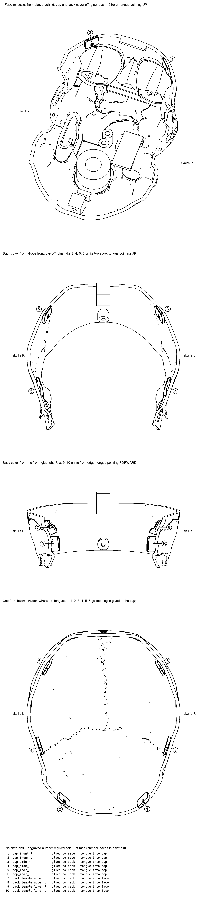

# Retrofit locator tabs (v1 covers)

The v1 cap and back cover sit on plain butt joints: 2.6 mm edges with nothing
to locate them. These tabs add the missing overlaps without reprinting
anything. Each tab is a small printed strip super-glued to the inside of one
part along a seam. Its other half (the tongue) sticks 7 mm past the seam and
slips inside the mating part. The tab is glued to one part only, so the covers
still come off. The tabs locate the parts, and the existing screws clamp them.

## Files
| file | what |
|---|---|
| `out/tabs_plate.stl` | all 10 tabs on one plate, in print pose |
| `out/NN_<name>.stl` | each tab on its own, in print pose |
| `out/assembled/NN_<name>.stl` | each tab in the skull frame (for viewing with the cover meshes) |
| `out/report.json` | per-tab frame, thickness and fit-check numbers |
| `placement.png` | where each numbered tab goes |
| `make_tabs.py` | the generator (about 90 s) |

Run it with `hardware/.venv/bin/python hardware/skull/tabs/make_tabs.py`.
It needs `hardware/skull/cache/render/` (the assembled-pose meshes) to place
the printed `out/face.stl`, `back.stl` and `cap.stl` in the skull frame.
Add `--draw-only` to redraw `placement.png` alone.

## Tabs
| # | name | seam | glued to | tongue goes into | print pose |
|---|---|---|---|---|---|
| 1, 2 | cap_front_R / L | cap / face, forehead (x = ±36) | face | cap | flat |
| 3, 4 | cap_side_R / L | cap / back, sides (y = 50) | back cover | cap | flat |
| 5, 6 | cap_rear_R / L | cap / back, rear (y = 125) | back cover | cap | flat |
| 7, 8 | back_temple_upper_R / L | back / face, temple (z = 21) | back cover | face | on edge |
| 9, 10 | back_temple_lower_R / L | back / face, temple (z = 7) | back cover | face | on edge |

L and R are the skull's own left and right (L = +X).

Placement keeps clear of the following:
- the forehead ledge (x within ±12): the forehead tabs sit at x = ±36;
- the cap screw boss at the back centre;
- the back-cover screw post (low at the back);
- the eye bar, LCDs, ESP32 and servo tray (all checked; at least several mm away);
- the cap/back/face corner at y = 32 on the cut.

A cap/face tab at each temple (around x = ±48, y = 15) was left out: the face has
an inward bulge just below the cut there, and a tab won't sit on it.

## Shape
- 13 mm wide along the seam. The glued half runs 8 mm back from the seam edge,
  and the tongue sticks 7 mm past it. Corners have a 3 mm radius.
- **Glued half:** its outer face is the glued part's inner surface, taken from
  the printed mesh at 0 mm offset (one-sample scan pits smoothed out).
- **Tongue:** its outer face sits 0.3 mm inside the mating part's inner wall.
  That wall is taken as the nearest one the tongue meets along the mating
  part's whole fitting path, so the tongue can't catch on the way in:
  - the cap: straight down the cut normal;
  - the back cover: straight down onto the floor lip (relative to the back
    cover, the face comes up past the tongue).
  
  The tip has a 45° lead-in chamfer on the outer face, down to 0.5 mm.
- **Tabs 1–6** have a flat inner face. They are 1.6 mm thick at the thinnest
  point and up to 2.9 mm where the wall curves. They print flat face down,
  with no support.
- **Tabs 7–10** cross the crease at the temple, where the wall bends about 45°
  through the seam. They are a constant 1.6 mm strip, printed standing on
  their long edge. The bend then lies in the layer plane, which is the strong
  direction, and needs no support.
- **Marks:** the V-notch in the outline marks the glued end. The tab number
  is engraved 0.4 mm deep in the inner face (the face you see from inside the
  skull), on the glued half.

## Fit-path check (all pass)
The script samples each finished tab mesh and checks it with ray tests:
- **Mating part on its fitting path** (cap: 25 mm down the cut normal; face
  relative to the back cover: 45 mm): 0.00–0.02 mm overlap (numerical noise).
  The tongue's fitted gap to the wall is 0.29–0.47 mm (the target is 0.3).
- **Glued part:** at most 0.1 mm overlap. This is the glue face lying on the
  wall.
- **Tabs on the back cover:** checked over the cover's 60 mm drop against the
  face, eye bar, LCD modules, screens, servo tray and both ESP32 positions:
  0 mm.
- **Tabs 7–10 against the cap coming down:** 0 mm.
- **Tabs 1–2:** checked against the eye bar, modules and screens: 0 mm.

## Print
- PLA, 0.2 mm layers, no support. Use 4+ walls or 100 % infill (the tabs are
  tiny).
- Tabs 7–10 stand 13 mm tall on a 1.6 × 15 mm foot. Use a 5 mm brim (or a
  brim on the plate) and glue stick.
- One plate, 79 × 63 mm, about 3.6 cm³ (around 5 g). Expect roughly 30 min.

## Gluing (CA gel, e.g. Loctite Super Glue Gel)
1. **Dry-fit first.** Hold each tab in its place (see `placement.png`):
   - the notched half lies flat against the inside of the part it's glued to;
   - the numbered face looks into the skull;
   - the small step between the halves sits right at the cut edge;
   - the tongue sticks out past the edge.
   
   The tab fits the wall's curve in only one spot. Slide it along the seam
   until it rocks least. Then fit the mating part over it once, to check it
   goes on.
2. **Glue.** Lightly sand the glue face and the wall, and wipe off the dust.
   Put a thin layer of gel on the **notched half only**, keeping 2 mm back
   from the step. That stops glue creeping onto the tongue or the seam.
3. **Press** it in place for about 30 s, with the step on the cut edge.
4. **Self-align.** Within the first minute, fit the mating part once, lightly
   and without the screw: the cap straight down, or the back cover down onto
   its lip. That pushes the tongues into line. Then take the part off again
   before the glue grabs it. Let the glue cure for 10 min before the final
   fit.
5. **Where each tab goes:**
   - 1–2 on the face (forehead);
   - 3–6 on the back cover's top edge;
   - 7–10 on the back cover's front edge at the temples.
   
   Nothing goes on the cap.
6. **Assembly order is unchanged:**
   - The back cover drops onto its lip. Its tongues 7–10 slide down inside
     the face's temple walls. Fit the back-cover screw.
   - The cap drops straight down over tongues 1–6. Fit the cap screw.

The tongues locate the cap sideways and front to back, and the back screw
pulls the forehead against tabs 1–2. Nothing on the tongues stops the front of
the cap lifting straight up. If it does, a dab of hot glue or a strip of tape
across the forehead seam holds it, and both come off.
